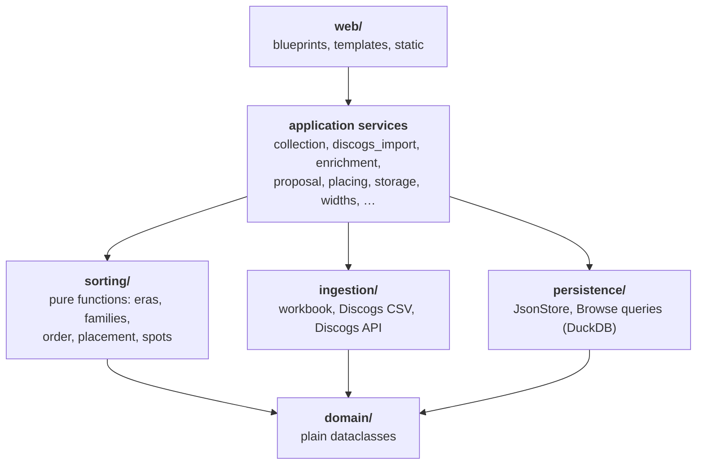
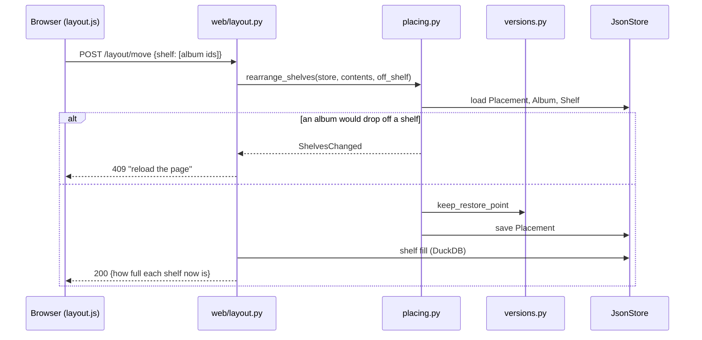

# Architecture

## 🏛️ Layers

| Path | What it holds |
| --- | --- |
| `src/sleeve_shelf/domain/` | Plain dataclasses, standard library only. No storage or web knowledge. |
| `src/sleeve_shelf/ingestion/` | Reading the outside world: the layout workbook, the Discogs CSV export, the Discogs API, the format-string parser. |
| `src/sleeve_shelf/sorting/` | The sorting engine: pure functions on domain objects. |
| `src/sleeve_shelf/persistence/` | `JsonStore` (one JSON file per entity) and the read queries for Browse. |
| `src/sleeve_shelf/*.py` | Application services that tie the layers together, such as `placing` (moving albums by hand, location rules), `storage` (cabinets and shelves), `taking_part` (which albums are sorted and which shelves a proposal fills). |
| `src/sleeve_shelf/web/` | Flask blueprints, templates, static files. One blueprint per screen. |

A blueprint never writes to the store itself: it reads and checks the form, calls a service, and turns the service's outcome into a page or a redirect. Business rules — *only an empty shelf can be removed*, *nothing drops off a shelf during a drag* — live in the services, where they have tests of their own.

!!! warning "A service and a blueprint can share a name"
    `sleeve_shelf/storage.py` and `sleeve_shelf/web/storage.py`, likewise `versions`. In web modules import names explicitly — `from sleeve_shelf.storage import save_shelf` — not `from sleeve_shelf import storage`, which can resolve to the blueprint.

## 🧵 A request, start to finish

Dragging a block on the Layout screen, as an example:

## 🍔 The menu and its counts

The five menu sections and their tabs are declared once, in `web/navigation.py`; a new screen gets its tab there. Each section also has an icon, named after the section's key, in the sprite `web/static/vendor/menu-icons.svg`.

What waits for a decision — matches, family suggestions, albums without a place, shelves over a measured width — is counted in one place, `web/waiting.py`. The counts feed both the Dashboard and the numbers in the menu. Working them out takes a while (family suggestions compare every artist with every other), so they are kept until a data file or `config.yaml` changes.

Each tab also names the part of the user guide that explains its screen, as `help="user/shelves/#layout"`; pages that share a tab but have their own part are in `PAGE_HELP`. The **?** beside the tabs links there. The app serves the documentation site itself under `/help/` (`web/help.py`): the Docker image builds it with Zensical and carries it in `/app/help`; a local run uses `docs-site/site` once built, and GitHub Pages otherwise. `tests/test_help.py` checks that every page and anchor named exists — rename a heading in the guide and the test says which screen to update.

Screens that need a collection are listed in `NEEDS_COLLECTION` in `src/sleeve_shelf/__init__.py`; without a collection they lead to the setup wizard.

## 🖼️ Covers and pictures

Covers and artist pictures are hotlinked from Discogs until the fetch run has stored them in `data/covers/albums/` and `data/covers/artists/`. The template filter `local_cover` picks the stored copy when there is one. Every page has to work without them. Pictures a user adds are kept apart in `data/artist_pictures/`, with a small copy made by Pillow, and are never touched by a sync.
