# Data model

## 🗃️ Entities

The diagram is the one in `docs/requirements.md`, the source of truth; a test keeps the two the same.

```mermaid
erDiagram
    AliasGroup |o--o{ Artist : "groups"
    Artist ||--o{ Album : "has"
    Artist ||--o{ EraBand : "is split into"
    EraBand |o--o{ Album : "contains"
    Album }o--o{ "Style" : "tagged with"
    Cluster ||--o{ "Style" : "groups"
    Artist ||--o| ArtistClusterAssignment : "has cluster"
    Cluster |o--o{ ArtistClusterAssignment : "assigned to"
    Cabinet ||--o{ Shelf : "has"
    Cabinet ||--o{ LocationRule : "mandatory cabinet of"
    Cabinet ||--o{ RuleSuggestionDismissal : "turned down for"
    Shelf ||--o{ Placement : "holds"
    Shelf ||--o{ ProposedPlacement : "would hold"

    Artist |o..o{ LocationRule : "target"
    AliasGroup |o..o{ LocationRule : "target"
    Cluster |o..o{ LocationRule : "target"
    Album |o..o{ LocationRule : "target"

    Album ||--o| Placement : "stands at"
    Album ||--o| ProposedPlacement : "would stand at"

    ReleaseEnrichment |o..o{ Album : "release_id"
    MasterEnrichment |o..o{ Album : "master_id"
    MasterEnrichment |o..o{ ReleaseEnrichment : "master_id"
    ArtistEnrichment |o..o{ Artist : "discogs_artist_id"
    Album ||--o| MatchProposal : "proposed for"
    Album ||--o| AlbumListening : "listened to via"
    Artist ||--o| FamilyDismissal : "turned down as anchor"

    Artist {
        int id PK
        string name
        int alias_group_id FK "nullable"
        int start_year "nullable"
        int discogs_artist_id "nullable, set by a sync"
        string picture_file "the user's own picture; nullable"
    }
    AliasGroup {
        int id PK
        string label
    }
    Album {
        int id PK
        int artist_id FK
        string title
        int release_id "Discogs, from CSV; nullable until matched"
        int master_id "Discogs, fetched"
        int original_release_year "fetched via master"
        object format_tokens "parsed from CSV Format"
        float computed_width_cm "nullable until matched"
        float manual_width_cm "nullable, overrides computed"
        bool width_confirmed
        list style_ids FK
        int era_band_id FK "nullable"
        string cover_url "small cover image at Discogs, set by a sync"
        string cover_image_url "large cover image at Discogs, set by a sync"
        bool original_year_confirmed
        bool left_discogs "release no longer in the Discogs collection"
        bool kept_after_discogs "kept although it left Discogs; not asked about again"
        bool new_purchase "added to an artist with a confirmed cluster; not yet weighed against it"
        date added_on "day a sync or import added it; nullable"
    }
    "Style" {
        int id PK
        string name "from Discogs"
        int cluster_id FK
    }
    Cluster {
        int id PK
        string name
        int position "place in the cluster sequence"
    }
    ArtistClusterAssignment {
        int artist_id PK, FK
        int cluster_id FK
        bool confirmed
    }
    EraBand {
        int id PK
        int artist_id FK
        string label "decade band"
        int position "order within the artist"
        string source "algorithm or initial load"
    }
    Cabinet {
        int id PK
        string name
        string location "room, nullable"
        int position "order of the cabinets"
        bool outside_sorting "left as it is by a proposal"
    }
    Shelf {
        int id PK
        int cabinet_id FK
        string name "label within the cabinet"
        float width_cm "nullable"
        string type "top-loader or front-loader, nullable"
        string layer "top or bottom, nullable"
        int reachability_score "nullable"
        bool is_showcase "top-loaders only; holds a sample, kept by a proposal"
        int position "order within the cabinet"
        bool width_measured "the width was measured, not estimated"
    }
    LocationRule {
        int id PK
        string target_type "artist, alias group, cluster or album"
        int target_id FK
        int cabinet_id FK
        string note
    }
    Placement {
        int album_id FK
        int shelf_id FK
        int position "order within the shelf"
        string source "algorithm, manual or initial load"
    }
    ProposedPlacement {
        int album_id FK
        int shelf_id FK
        int position "order within the shelf"
        string source "algorithm, manual or initial load"
    }
    RuleSuggestionDismissal {
        string target_type "artist, alias group, cluster or album"
        int target_id FK
        int cabinet_id FK
    }
    ReleaseEnrichment {
        int release_id PK
        list styles "style names"
        int master_id
        int year
        datetime fetched_at
    }
    AlbumListening {
        int album_id PK, FK
        datetime checked_at "when Deezer was last searched"
        int deezer_album_id "nullable: none found"
        string deezer_title "nullable"
        string deezer_artist "nullable"
        string deezer_cover "nullable"
        bool turned_down "the user said it is another album"
        list video_titles "nullable until Discogs was asked"
        list video_urls "nullable until Discogs was asked"
    }
    MatchProposal {
        int album_id FK
        int release_id
        string artist
        string title
        float score
        object format_tokens "format of that release"
        string cover_url "small cover of that release, from a sync; nullable"
        string cover_image_url "large cover of that release; nullable"
    }
    FamilyDismissal {
        int anchor_artist_id PK, FK
    }
    MasterEnrichment {
        int master_id PK
        int original_release_year
        datetime fetched_at
    }
    ArtistEnrichment {
        int discogs_artist_id PK
        string image_url "picture at Discogs, nullable"
        string thumb_url "150 px, nullable"
        datetime fetched_at
        list member_ids "Discogs ids of a band's members; nullable"
        list group_ids "Discogs ids of the bands a person is in; nullable"
        list alias_ids "Discogs ids of the artist's other names; nullable"
    }
```

The core of it:

- An **Artist** has **Albums**, belongs to one **Cluster** through an **ArtistClusterAssignment** (confirmed, or proposed by the app), and optionally to an **AliasGroup** — a family.
- A **Cabinet** has **Shelves**. A **Placement** stands an album on a shelf at a position; a **ProposedPlacement** does the same for a proposal waiting for a decision.
- A **LocationRule** binds a cluster, family, artist or album to a cabinet.
- **ReleaseEnrichment**, **MasterEnrichment** and **ArtistEnrichment** cache what the Discogs API returned, so it is never fetched twice.

## 💾 Files on disk

Everything lives in the data directory (`SLEEVE_SHELF_DATA_DIR`, default `data`):

| File or folder | Holds |
| --- | --- |
| `artists.json`, `albums.json`, `clusters.json`, … | One file per entity, a JSON array with one object per line — readable and diffable by hand |
| `placement_current.json` | Where every album stands now |
| `placement_proposal.json` | A proposal waiting for a decision; removed when accepted or discarded |
| `placements/` | Saved versions of the layout, one full snapshot per file |
| `listening.json` | Where an album can be listened to: its album at Deezer, its release's videos on Discogs |
| `discogs_releases.json`, `discogs_masters.json`, `discogs_artists.json` | The Discogs cache — hours of fetching at Discogs' rate limit; never delete it |
| `covers/albums/`, `covers/artists/` | Images stored by the fetch run |
| `artist_pictures/` | Pictures the user added; never touched by a sync |
| `id_marks.json` | The highest id ever handed out per entity |
| `config.yaml` | Settings and the Discogs token; never committed |

## 🦆 DuckDB as the read/write layer

`JsonStore` (in `persistence/store.py`) reads each file with DuckDB's `read_json()` and an explicit column schema per entity, and writes it with `COPY … TO`, first to a temporary file that is then swapped in. The read queries behind Browse — shelves in walking order, the albums of a shelf, search, how full each shelf is — run as SQL directly on the JSON files. The sorting itself is not SQL: it is plain Python on domain objects.

!!! warning "`save` rewrites the whole file"
    Load the list, change it, save the list. And a query that reads several entity files fails while one of them doesn't exist yet: check `store.exists(...)` first.

## 🔢 Ids are never reused

A new item gets its id from `store.next_id(Entity, items)` — never from "highest + 1". Saved versions name albums and shelves by id, and location rules name their target and cabinet by id; a reused id would make an old version put a new album on a removed album's spot. The highest id ever given out per kind is kept in `id_marks.json`.

## 🧰 Adding a field

A new field on an entity goes in three places:

1. the dataclass in `domain/`;
2. its column list in `persistence/store.py` (`_TABLES`), with a decoder if it is not a plain type;
3. the data model in `docs/requirements.md` — the entity list and the Mermaid diagram — and so in this page.

Data saved before the field existed has no value for it: decide what that means (for example in `__post_init__`), so old files keep loading.
