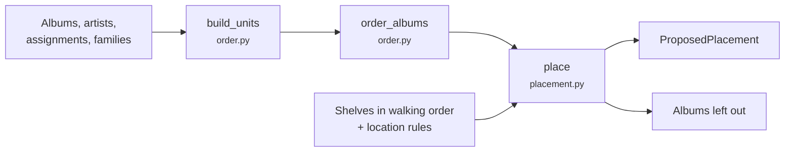

# Sorting engine

The sorting engine in `sorting/` is a set of pure functions on domain objects: no storage, no web. The application services load what it needs, call it, and save the result. That keeps every step testable on its own, with lists of dataclasses.

## 🏗️ From collection to proposal

1. **`build_units`** turns artists into *units*: an artist on its own, or a family taken as one. Each unit gets a cluster (confirmed, or proposed — see below), an era band from its start year (`eras.band_of`), and a sort name.
2. **`order_albums`** puts every album in its place in one long row: by the clusters' order and era band; within a band the units, and within a unit the albums, keep the order they stand in now (`standing`, each album's place along the walked shelves, from `proposal._standing`). Only what stands nowhere yet goes by unit name, or by original year and title, before the first standing one the rule puts after it (`_keep_order`). `sort_collection(store, unplaced)` treats albums being moved as standing nowhere.
3. **`place`** fills the shelves with that row, in walking order. A shelf takes albums until the next one no longer fits; a shelf once passed is not gone back to. Location rules restrict albums to a cabinet, and a cabinet a rule points to takes only its bound albums. What doesn't fit is returned, not forced in.

`proposal.py` runs these steps and saves the result as a `ProposedPlacement`; `taking_part.py` decides which albums take part (LPs, and whatever already stands on a shelf) and which shelves are filled (not a showcase, not a cabinet kept outside the sorting, not a shelf without a width).

## 🧲 Clusters from styles and connections

An artist without a confirmed cluster gets a proposed one:

- **`sorting/connections.py`** looks at whom Discogs directly connects the artist to — its other names, a band of its own — and proposes their confirmed cluster. Loose connections (a band several artists share, a sideman's bands) only indicate; they don't decide.
- Without a close connection, **`order.propose_cluster`** takes the cluster most of the artist's albums' styles point to; on a tie, the cluster of its earliest album.

A style is mapped to the cluster most of the artists carrying it were curated into.

## 🤝 Families

**`sorting/families.py`** suggests families in two ways. From the names, an artist whose name appears inside others' names gathers them. From Discogs membership, an artist is joined with its other names and with the bands it is in — but nothing is chained through fellow members, a band shared by two artists in the collection belongs to neither, and a person in more of the collection's bands than the setting `sideman_bands` (default 4) counts as a sideman. Both modules take the limit as `max_bands`; `alias_groups.py` reads it from the settings. An existing family is only ever extended.

## 🎯 A spot for a new purchase

**`sorting/spots.py`** finds a spot for an album that stands on no shelf, in the layout *as it stands* rather than in a fresh sorting: next to the artist's other albums, else among the artists of the same era band in its cluster, else in its cluster, else where its cluster comes in the order. Only the cabinet holding most of those albums counts, so a few albums kept elsewhere are no place to add to. Room on the shelf is reported, not enforced.
