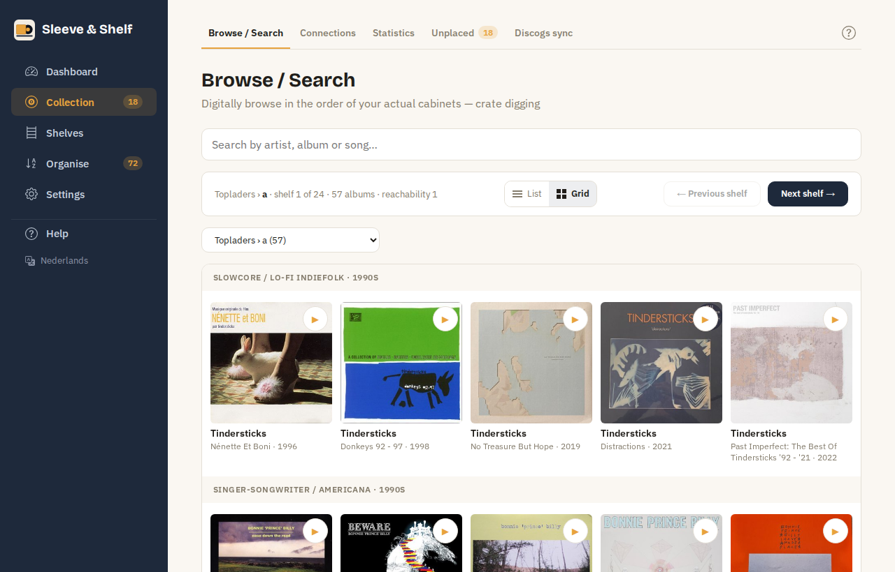
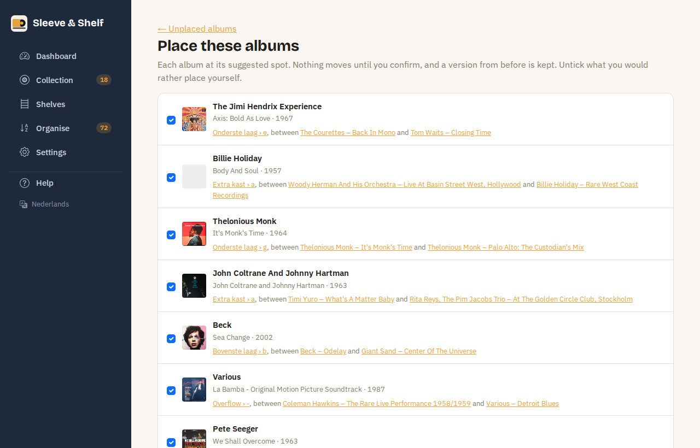

# Browsing and searching

## 🔎 Browse and search

**Browse** shows one shelf at a time, in the order the albums actually stand — crate digging on a screen. Step through the shelves with *Previous shelf* and *Next shelf*, or jump to one with the list of shelves. The albums are grouped by cluster and era band, so you see where one section ends and the next begins.

Every album has a **▶** button: it plays the album's 30-second previews from Deezer, one track after another, and shows the track playing under the title. Press it again to stop; pressing another album stops the first. When Deezer doesn't have the album, the row says so — its page may still have videos.

The switch in the bar shows a shelf or search results as a **list** or as a **grid** of covers, and this device remembers your choice. The bar says which shelf you are at. The arrow keys, or a swipe on a phone, go to the previous or next shelf.

**Search** finds artists, albums and songs across all shelves. The results follow as you type; a row opens the album's page, the artist its page, and the place beside it the shelf with the album marked. From any other page, the search field in the menu leads here too. Emptying the search field takes you back to browsing.

Every word you type has to be in the artist and title, or in the artist, title and one song together: *waits martha* finds the Tom Waits album with *Martha* on it. An album found by a song names that song under its title, with its place on the record (♪ B1 · Martha). Songs are known once the fetch run has brought the tracklists from Discogs (see [Fetching styles, years and pictures](discogs.md#fetching-styles-years-and-pictures)).

## 📦 Albums without a place

**Unplaced** lists the LPs that stand on no shelf yet — new purchases, and albums a proposal had no room for. For each one the app suggests a spot in your shelves as they stand now: the shelf, the two albums it would go between, and whether it fits. *Put it there* places it; nothing else moves.

With more than one waiting, **Place all at once…** shows every album at its suggested spot and what that does to each shelf. Untick what you would rather place yourself; **Place them** stands the rest in one go, and a version from before is kept.

New purchases carry a **New** label and come first. The Dashboard shows the first three as well.

!!! info "Singles and EPs"
    Only LPs are sorted. 7", 10" and 12" singles and EPs are imported and listed, but never given a spot — unless they already stand on a shelf.
