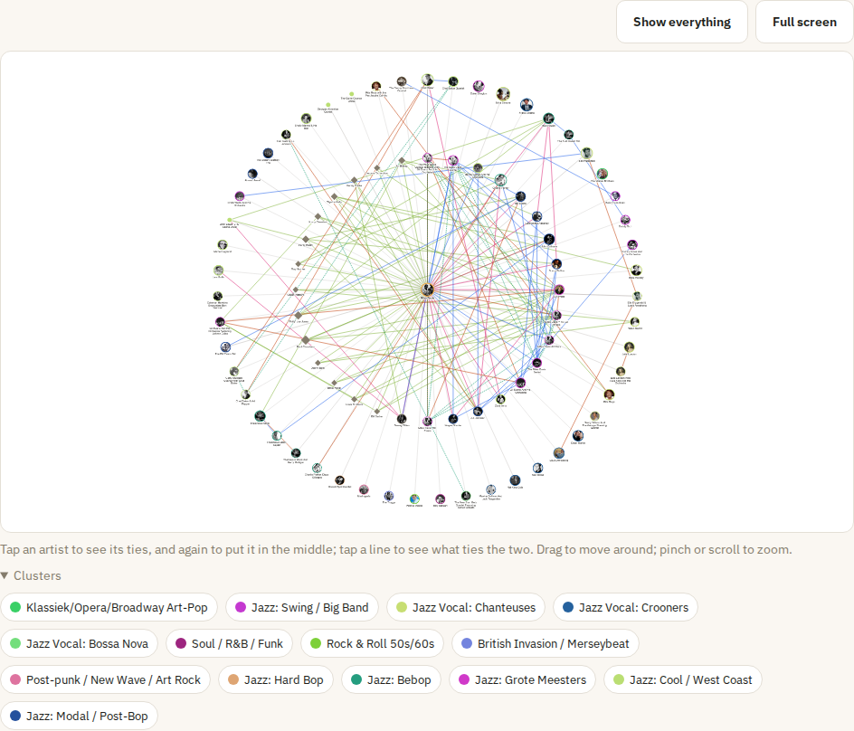

# Connections and statistics

How the artists in your collection hang together, and who and what recurs across it.

## 🕸️ Connections

**Connections** shows how the artists in your collection are tied together, as a network you can move around in. Every point is an artist — bigger with more albums, coloured by its cluster (grey means no cluster yet). Every line is a tie:

| Line | What ties the two |
| --- | --- |
| **Member** | a person in a band, as Discogs lists it |
| **Other name** | another name of the same artist, as Discogs lists it |
| **In the name** | one name inside the other: *Chet Baker Quartet* and *Chet Baker*, *Duke Ellington & John Coltrane* and both. If that misleads — Moondog Jr. only took his name from Moondog — press **Not related** at that artist in the list; **Undo** below the list takes it back |
| **Family** | both are in one [artist family](sorting.md#artist-families) |
| **On the record** | one is credited on an album of the other as musician, singer, arranger, conductor or producer: Bud Powell on Charlie Parker's *Massey Hall* |
| **Musician** | a musician or singer without an album of their own, on five or more of your albums: a diamond, with a line to the artist of each. Band members on their own band's albums and producers don't count |
| **Same label** | albums of both on one record label — of your own pressing, so a reissue label counts too. Starts switched off. Labels that reissue others' records tie no one; which those are is a list under [Settings](settings.md) |
| **Same song** | albums of both have the same song — *Summertime*, *'Round Midnight*; the more songs, the thicker the line |

The switches above the network show or hide each kind. Songs are compared without case, accents and what stands between brackets at the end, so *'Round Midnight (Take 2)* is *Round Midnight*; titles such as *Intro* or *Interlude* tie no one, and neither do compilations (*Various*). Two songs of the same title are told apart by **who wrote them**, as Discogs lists it: Bud Powell's *Yesterdays* (Jerome Kern) and Guns N' Roses' are different songs, so they tie no one. Where Discogs names no writer — often on old jazz records — the song counts when every other song of that title in your collection is the same one. The writers come with the fetch run; until it has run once, the title alone decides. Members and other names are known once the fetch run has fetched the artists from Discogs, songs and credits once it has fetched the releases. Besides the artists in your collection, musicians on five or more of your albums are points too; they have no artist page, but tapping one shows the albums they are on.

**Around one artist**: search an artist on the screen, or press **Connections** on an artist's page. The artist stands in the middle with everyone tied to it around it — Artists tied by more than a song stand closest. **Two steps out** adds whom those are tied to — by anything but a song, or the network would hold most of your jazz. Here every artist shows its picture, with its cluster's colour round it; a joint billing, which has no picture of its own, borrows that of an artist it names, with a dashed ring. Below the network the same ties are listed, with the songs two artists share — and the **albums to take from the shelf**: the other artist's albums, each with the songs it shares, who is credited on it and where it stands — when a song or a credit is all that ties the two, only the albums it is on — and the albums of the artist in the middle with a shared song or the other's credit. Choosing one opens its shelf with the album marked.

**The whole collection**: without an artist chosen, every artist with a tie is shown. *Same song* starts switched off here, as it ties nearly every jazz artist to every other; names appear as you zoom in. Placing everyone takes a moment; the network says so while it loads.

Tap an artist once to light it up with its ties — the rest fades, and the line under the network says who it is — and again (or **Put in the middle**) to put it in the middle. On the whole collection the network zooms in to it. Tap the background to light everything up again, or a line to see what ties the two. Drag to move around, and pinch (or scroll) to zoom; **Show everything** fits the network back on the screen.

On a phone a finger on the network moves the network rather than the page, so it stands a little lower there; **Full screen** gives it the whole screen until you press **Close**. Under the network the **clusters** in view are listed with their colour: tap one to light up its artists.

While you type an artist in the search field, the artists of the network are offered: choosing one lights it up on the map, or opens its connections when it is not in view. Switches you change stay as you set them while you go from artist to artist, and above the heading **your way here** — the artists you put in the middle one after another — takes you back. In the list each tie's albums are folded away under their number; lighting up an artist offers **Its albums in the list**.

**The way to another artist**: around one artist, search a second one under *The way to another artist*. The network then shows only the artists between the two — the shortest way along the ties switched on, through bands, names, families and credits where it can, through shared songs and labels where it must — and the list the steps one by one. *Tom Waits › Nina Simone › Chet Baker*: who would have thought. Visitors can look at the connections too.

## 📊 Statistics

**Statistics** shows who and what keeps coming back in your collection. Open a line to see its albums and where each stands.

- **From the shelf today**: an album to pull out, the same all day, with *Another one* for the next — and those from fifty years ago this year.
- **Who holds your collection together**: the artists with the most ties by band, name, family or credit, and the longest way between two of them.
- **Most on your records**: musicians and singers credited on the most albums of others — also those without an album of their own, the bassist on ten of your records. Producers don't count, nor does anyone named on the record itself, nor a member of the band on that band's albums.
- **Most recorded songs**: the songs on albums of the most artists, told apart by who wrote them where Discogs says so.
- **Record labels**: the labels with the most albums. These are the labels of your own pressings, so a reissue counts for the label of the reissue.
- **Per decade** and **per cluster**: how your collection is spread out.

Credits and labels come with the fetch run; until it has run, those parts say so.
