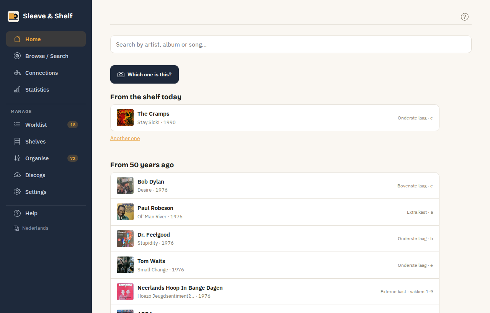
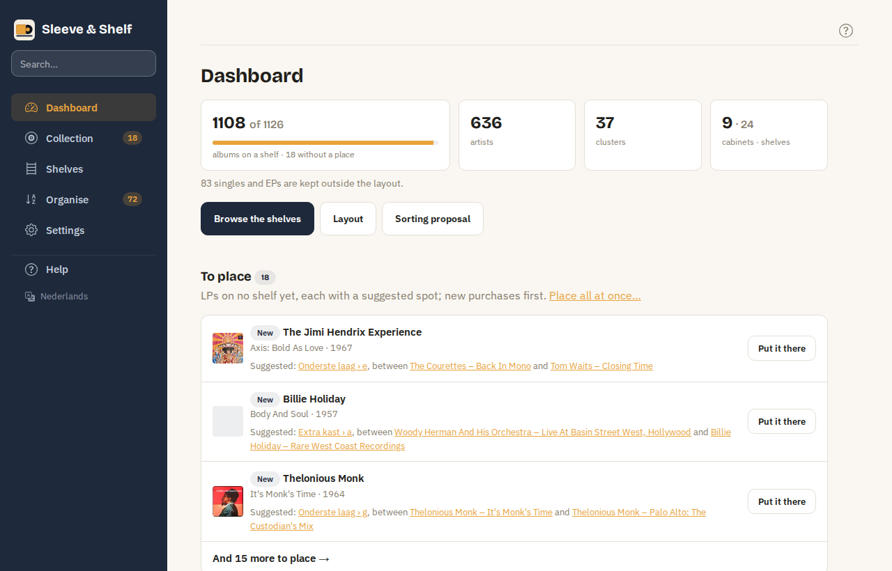
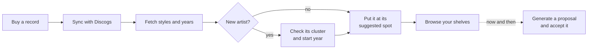

# User guide

Sleeve & Shelf keeps track of where every record in your collection stands, and helps you decide where it *should* stand. This guide walks through the app the way you use it: from getting it running, to browsing your shelves, to letting it propose a new layout.

## 🏠 Home

The app opens on **Home**: a search field for an artist, album or song, and something to play. Typing shows the results in its place; emptying the field brings Home back.

- **From the shelf today** — one album from your shelves, the same all day; **Another one** picks a different one.
- **From 50 years ago** — albums from your collection that came out fifty years ago this year.
- **Recently added** — the albums a Discogs sync or import brought in last.

**Which one is this?** opens your phone's camera. Take a photo of a sleeve, and the app tells you which album it is and where it goes back: the cabinet and shelf, and between which two albums. When it isn't sure — two volumes of a series with the same sleeve, say — it shows the albums it may be, with their covers; tap the right one. It works best with the whole front of the sleeve on the photo, straight on, in good light and out of a top-loader. The photo is not kept. Visitors may use it too.

When something waits for a decision, a line at the bottom says how many things, and leads to the Dashboard. Visitors see Home too, without that line.

## 🗺️ The sections

Each section of the menu opens on its first screen; the other screens of a section are tabs at the top of the page.

The menu has two blocks. The first is for looking things up and finding something to play; the second, under **Manage**, is for keeping the collection up to date. Visitors see only the first.

| Section | Screens | What you do there |
| --- | --- | --- |
| **Home** | Home | Search, and find something to play |
| **Browse / Search** | Browse / Search | Walk along your shelves, or search by artist, album or song |
| **Connections** | Connections | See how the artists hang together |
| **Statistics** | Statistics | See who and what keeps coming back |
| *Manage* | | |
| **Worklist** | Dashboard · Unplaced | See what is waiting for you and the steps towards a new layout; place the albums without a spot |
| **Shelves** | Layout · Move · Proposal · Showcase · Versions · Cabinets | Rearrange the shelves, move an album, artist, family or cluster at once, let the app propose a layout, manage top-loaders, go back to an earlier layout, describe your cabinets |
| **Organise** | Artists · Families · Clusters · Rules | Decide what belongs together and where: an artist's cluster and start year, which artists stand together, the order of the clusters, and fixed places |
| **Discogs** | Discogs sync | Bring the collection in from Discogs, and fetch styles, years and covers |
| **Settings** | Settings | Width estimates, the Discogs token, light or dark |

A number next to a section or tab tells you how many things wait there for a decision — matches to confirm, suggested families, albums without a place, shelves that are too full.

The **?** beside the tabs opens the part of this guide about the screen you are on; **Help** at the end of the menu opens the guide itself.

## 🔁 A typical round

Most days you only browse. After buying records you sync, and each new album gets a suggested spot among the albums already on your shelves. Once in a while — after many purchases, or a new cabinet — you let the app propose a whole new layout and compare it with what you have.

## 💡 Words used in this guide

Cluster
:   A group of artists that belong together by sound, such as *Jazz: Hard Bop* or *Slowcore / Lo-fi Indiefolk*. You name them; Discogs styles only suggest which cluster a new artist belongs in.

Era band
:   The decade an artist started in: before 1960, 1960s, …, 2020s and later. Within a cluster, artists stand by era band.

Family
:   An artist's other names, bands and side projects that stand together as one: *Chet Baker*, *Chet Baker Quartet* and *Chet Baker & Crew*.

Location rule
:   A fixed place: a cluster, family, artist or album that always goes in a certain cabinet.

Showcase
:   A top-loader shelf that holds a sample of an artist's albums, facing front.

Proposal
:   A sorted layout the app worked out. It stands next to your real layout until you accept or discard it.
