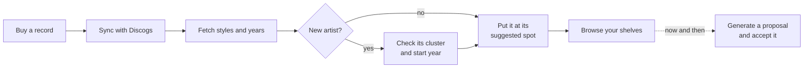

# User guide

Sleeve & Shelf keeps track of where every record in your collection stands, and helps you decide where it *should* stand. This guide walks through the app the way you use it: from getting it running, to browsing your shelves, to letting it propose a new layout.

## 🗺️ The five sections

The menu has five sections. Each opens on its first screen; the other screens of a section are tabs at the top of the page.

| Section | Screens | What you do there |
| --- | --- | --- |
| **Dashboard** | Dashboard | See what is waiting for you, and the steps towards a new layout |
| **Collection** | Browse / Search · Unplaced · Discogs sync | Look up records, place the ones without a spot, bring the collection in from Discogs |
| **Shelves** | Layout · Proposal · Showcase · Versions · Cabinets | Rearrange the shelves, let the app propose a layout, manage top-loaders, go back to an earlier layout, describe your cabinets |
| **Sorting** | Artists · Families · Clusters · Rules | Decide what the sorting goes by: an artist's cluster and start year, which artists stand together, the order of the clusters, and fixed places |
| **Settings** | Settings | Width estimates, the Discogs token, light or dark |

A number next to a section or tab tells you how many things wait there for a decision — matches to confirm, suggested families, albums without a place, shelves that are too full.

The **?** beside the tabs opens the part of this guide about the screen you are on; **Help** at the end of the menu opens the guide itself.

## 🔁 A typical round

Most days you only browse. After buying records you sync, and each new album gets a suggested spot among the albums already on your shelves. Once in a while — after many purchases, or a new cabinet — you let the app propose a whole new layout and compare it with what you have.

## 💡 Words used in this guide

Cluster
:   A group of artists that belong together by sound, such as *Jazz: Hard Bop* or *Slowcore / Lo-fi Indiefolk*. You name them; Discogs styles only suggest which cluster a new artist belongs in.

Era band
:   The decade an artist started in: before 1960, 1960s, …, 2020s and later. Within a cluster, artists stand by era band.

Family
:   An artist's other names, bands and side projects that stand together as one: *Chet Baker*, *Chet Baker Quartet* and *Chet Baker & Crew*.

Location rule
:   A fixed place: a cluster, family, artist or album that always goes in a certain cabinet.

Showcase
:   A top-loader shelf that holds a sample of an artist's albums, facing front.

Proposal
:   A sorted layout the app worked out. It stands next to your real layout until you accept or discard it.
