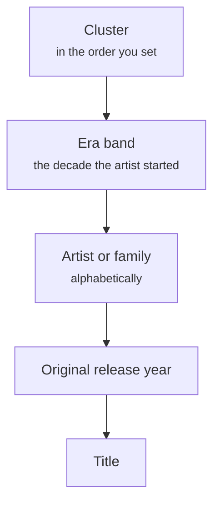

# How the sorting works

The app follows the way a collection is sorted on real shelves: related music together, older artists first, and an artist's records never scattered.

## 🧩 Clusters

A **cluster** is a group of artists that belong together by sound. You name the clusters and set their order across the shelves on the **Clusters** screen; related clusters follow each other, such as the jazz clusters. Each artist belongs to exactly one cluster.

For a new artist the app **proposes** a cluster:

1. the cluster of the artists Discogs closely connects it to — its other names, or a band of its own;
2. otherwise the cluster most of its albums' Discogs styles point to.

A proposed cluster is marked *proposed* until you confirm it; the artists to check are listed under **Artists → To check**.

When a new purchase makes an artist's styles point to another cluster than the one it stands in, the app says so and waits: **Move** the artist, or **Keep** it where it is. Nothing moves by itself.

To move a **whole cluster** or **family** at once, use **Move…** on its page, which opens the [Move](shelves.md#move) screen.

## 👪 Artist families

A **family** keeps an artist's other names, bands and side projects together as one unit. The app suggests families:

- **from the names** — *Chet Baker* gathers *Chet Baker Quartet* and *Chet Baker & Crew*;
- **from Discogs** — an artist under several names, or a person with the bands they are in: *Nick Cave* gathers *Grinderman* and *The Birthday Party*. Someone in more than four bands of your collection is taken to be a sideman, whose bands are not suggested as their family; you can change that number under Settings.

On the **Families** screen you accept a suggestion (leaving out members you don't want), turn it down for good, or make families by hand. *Accept all* asks first how many families it is about to make.

## 🕰️ Era bands and order

An artist's **start year** decides its **era band**: before 1960, the 1960s, and so on to the 2020s and later. The whole catalogue of an artist stays in that band, so reissues and late albums don't scatter it. When the start year is not known, the earliest original release year among its albums stands in; you can always set it on the artist's page.

Within a cluster, artists stand by era band, oldest first. **Within a band, the artists keep the order they stand in on your shelves now**, and so do an artist's own albums: that order is yours — related artists side by side, albums by title if that is how you keep them — and the app doesn't overrule it. Only an artist or album that stands nowhere yet goes by the rule: artists alphabetically by name as written (so *The Stooges* is under T), an artist's albums by original year, then title — placed before the first one on the shelf that the rule puts after it.

## 📐 Filling the shelves

The sorted albums are stood on the shelves as one continuous row, in the order of your cabinets: a shelf is filled until the next album no longer fits, then the row runs on to the next shelf. A shelf without a width, a showcase, and a cabinet kept outside the sorting are skipped. What doesn't fit is not forced in: it is left without a place, and the proposal says how many.

Where one shelf ends and the next begins is chosen so that **as many albums as possible stay on the shelf they stand on now**. The order is exactly the same as filling every shelf to the brim; the shelves are just filled less evenly, so that carrying out a proposal takes far fewer records out of the cabinets. And every shelf keeps **10% of its width free** (a setting), so a few new purchases later don't set a whole cabinet moving. The proposal says how many albums go to another shelf and about how many **rounds of a table full** that is — how many records fit on your table is a setting too. With widths that are still estimates, the shelves are usually too full to leave much choice: measuring them is what lets this keep albums in place.

## 📍 Location rules

A **rule** binds a cluster, a family, an artist or a single album to a cabinet. A proposal places it there and nowhere else, and keeps everything without a rule out of that cabinet. The most specific rule wins: an album's own, then its artist's, its family's, its cluster's.

The **Rules** screen also suggests rules from your layout as it stands: when everything of an artist stands in one cabinet where a proposal would not put it, it suggests binding it there. Nothing is added until you say so.

## 🎛️ The sorting proposal

On the **Proposal** screen you generate a sorted layout. It stands next to your real layout: you can browse it, and adjust it in Layout, without anything changing on your shelves. **Accept** makes it your layout and saves it as a version; **Discard** leaves everything as it was.

## 🆕 New purchases

You don't need a new proposal for every record you buy. A new album gets a **suggested spot** in your shelves as they stand: next to the artist's other albums, or among the artists of the same era in its cluster. Find it under **Unplaced**, or on the Dashboard.
