# Requirements — Sleeve & Shelf

*As of: October 12, 2026*

**Sleeve & Shelf** is a self-hosted, open-source Python Flask web application (Bootstrap + JavaScript) that organizes a vinyl collection (~1,190 vinyl titles out of ~1,455 tracked releases on Discogs) across a record cabinet, based on musical kinship, artist era, and physical shelf space.

> The Discogs collection CSV export contains no style/genre data and no original-release-year data (see [Sorting logic](#sorting-logic) and [Data model](#data-model)) — both are fetched from the Discogs API during import. Confirmed against a real export on 2026-09-20.

## Goal, scope, and phasing

### Phase 1 — MVP

The MVP is delivered in two steps. The record cabinet has already been laid out by hand, so the first need is to get that existing layout into the app and browse it (1a); having the app generate and maintain a layout itself comes second (1b).

#### Phase 1a — Import & Browse

- **Initial load**: seed the collection and its layout from an already-worked-out XLSX workbook (example: `docs/import_example.xlsx`) — see [Initial load](#initial-load). This is the only import in 1a: no Discogs CSV, no Discogs API, no access token. Uploading again later only changes the layout
- **Browse/Search screen**: a dedicated main-nav screen for browsing the collection digitally, in *crate-digging* mode — it follows the actual physical order (cabinet → shelf → position) from the current placement, i.e. scrolling through it mirrors flipping through the real shelves. Includes search by artist and album (title-only search; no tracklist data is fetched, so song-level search is out of scope for Phase 1 — see Phase 3)
- **Unplaced albums** list: spreadsheet rows without a spot on a shelf stay visible rather than being dropped (see [Initial load](#initial-load))
- A short onboarding wizard: welcome → upload spreadsheet → browse (see [Onboarding wizard](#onboarding-wizard))

#### Phase 1b — Sorting

Everything the app needs to propose and maintain a layout itself. Builds on the data loaded in 1a, but also works without it (a user with no spreadsheet starts here).

- **Match the initially loaded albums to Discogs**: once the Discogs export is imported and enriched (next bullets), the albums from the 1a spreadsheet are matched to it, so they gain `release_id`, styles, original year, and width — see [Initial load](#initial-load)
- CSV import of a Discogs export; vinyl is detected by parsing the free-text `Format` field (tokens such as `LP`, `7"`, `10"`, `12"`, optionally prefixed with a quantity like `2x`) — there is no simple `Format == "Vinyl"` check. Whether a "bonus disc" bundle (e.g. `"CD + LP"`) counts as vinyl is a configurable setting, not a hardcoded rule — see Configuration
- **Discogs API enrichment during import**: for each vinyl release, fetch its styles and `master_id` from the release endpoint, then fetch the original release year from the master endpoint — required because the CSV export provides neither (see [Sorting logic](#sorting-logic)). This needs its own wizard step to configure the personal access token, moved up from Phase 2 into Phase 1
- Enrichment results (styles, master ID, original year) are cached locally per `release_id`/`master_id` so re-running the wizard or re-importing doesn't repeat already-fetched API calls
- Manage storage structure: cabinets and shelves (width in cm, type top-loader/front-loader, layer top/bottom, reachability score, showcase flag for top-loaders)
- Manually create artist alias/project groups (e.g. related projects by the same person)
- Manually configure location rules: fixed exceptions (cluster, family, artist, or album → mandatory cabinet), separate from the automatic proposal
- Generate a sorting proposal following the sorting logic (see below)
- Proposal is fully adjustable by hand (move between shelves, reorder)
- Onboarding wizard for first-time setup
- No album covers in Phase 1 — the standard Discogs CSV export does not include cover URLs, and cover art is out of scope for the Phase 1 API enrichment (built in Phase 2, see below)

### Phase 2 — Ongoing management

- **Live/ongoing** Discogs API integration: the one-time enrichment already happens in Phase 1 — Phase 2 extends this to keep the collection in sync (new purchases, changed collection data) rather than only at first import
  - **Built: sync on demand.** The collection is fetched straight from the Discogs API (the collection of the token's owner, 100 releases per request) and taken over exactly like a CSV export: same vinyl detection, same linking (see Discogs screen; a sync used to show a preview before anything changed, and is taken over at once since 2026-10-24). New vinyl becomes new, unplaced albums; albums whose release is no longer in the Discogs collection are marked and reported, and kept until the user removes them, which always takes a confirmation
  - **A sync brings the format of linked albums up to date** (decided 2026-10-09): disc count, 180 gram, gatefold and the other tokens are taken from the release, and the estimated width follows. A width measured by hand is not touched. An uploaded export does not do this — it knows the format less well than the API (see Discogs screen)
  - **A sync runs on demand only** (decided 2026-10-09): by the button on the Discogs screen; not at start-up or on a schedule — confirmed 2026-10-18 when closing Phase 2
  - **A sync also notes who the artists are made of** (built 2026-10-11): for each artist it stores the Discogs artist id, and the fetch run then caches the members, groups and aliases Discogs lists for that artist (see Data model). This is what family suggestions from Discogs are worked out from (see Sorting logic §1). An uploaded export cannot say which Discogs artist an artist is, so it brings none of this
- Add album covers to the Layout screen (Album gets a cover_url field)
  - **Stored locally** (2026-10-11): the images themselves are downloaded into the data directory, so covers and artist pictures show without an internet connection and no longer depend on Discogs keeping the addresses alive (see Storage and Discogs screen). A page shows the stored copy when there is one and the Discogs address otherwise
  - **Built** (2026-10-09), and wider than Layout: covers also show in Browse/Search, in the Unplaced albums list, and on an artist's page. A sync stores the address of each release's small cover image on the album (`cover_url`), and of the large one for enlarging a cover on the album's page (`cover_image_url`, added 2026-10-09); an uploaded export has no covers and leaves them alone. A sync only stores the addresses; the images themselves are stored by the fetch run (see Stored locally above). Until then the browser fetches them from Discogs when a page is shown
- Add new purchases, with a suggested spot within the existing layout
  - **Built** (2026-10-12). An LP that stands on no shelf yet is suggested a spot on the shelves as they are — a shelf, and the two albums it would stand between — and is put there only when the user says so (see Sorting logic §4, Unplaced albums and the Detail screen). It does not wait for measured shelf widths: whether it fits is said, not enforced
- Suggestions for new location rules based on the existing layout — always requiring confirmation, never applied automatically
  - **Built** (2026-10-11). The layout as it stands is compared with the proposal a sort without any rule would give. A cluster, family or artist whose albums all stand in one cabinet, while that proposal would put most of them in a cabinet more than one step away in walking order, is taken to be kept there on purpose — and so is an album standing apart from the rest of its artist (an artist with at least 4 albums, at least 75% of them in one cabinet). The most general explanation is suggested: what a cluster suggestion covers is not suggested again per family, artist or album. Suggestions are shown on the Location rules screen, per cabinet, and are added or turned down per cabinet; nothing is added by itself (see Location rules screen)
- Showcase management for the top-loaders (rotating samples from the collection)
  - **Built** (2026-10-09), as Mark described it: a showcase shows a sample of the artists that are well represented in the collection — a few albums of each, in proportion to how many the artist has, never all of them — while the rest stand on the artist's own shelf. Albums are exchanged between the two, one for one, and the selection is the user's own (see Showcase screen)
- Notification + confirmation when a new purchase would shift an existing artist's cluster
  - **Built** (2026-10-10). An album that a sync or import adds to an artist whose cluster is confirmed is marked as a new purchase (`new_purchase`). Once it has its styles, the cluster the artist's styles point to with the purchase is compared with the one they pointed to without it; when the purchase makes them point to another cluster than the artist's own, that is a shift. It is shown — never applied — until the user moves the artist or keeps it where it is (see Sorting logic §4 and Artists screen)

**Phase 2 is closed** (2026-10-18). Mark settled what was left open and confirmed the choices made without asking:

- **Externe kast and Externe koffer** are better kept outside the sorting, as the suggested spots get much better that way. That is a setting for the owner under Cabinets & shelves; nothing is built for it
- **A full shelf** is reported when a spot is suggested; the app does not offer to make room. Making room means moving albums, which is what a sorting proposal is for, and that never moves anything silently
- **The showcase** suggests no sample size per artist: what stands on display is the owner's own choice
- **A sync** runs on the button only
- **Confirmed**:
  - a suggested spot is found in the layout as it stands, and albums kept apart are not gone by
  - a cluster shift is weighed per artist, not per family
  - the thresholds of rule suggestions: 2 albums for a cluster, family or artist; 4 albums and 75% for an album apart
  - both sizes of every image are stored, and an artist picture is fetched once and never refreshed
  - a family from Discogs is named after the person, not a band, and nothing is chained through fellow members
  - a showcase may be filled to 60% of its width, a setting
  - for listening, Deezer's title must be 80% and the artist 70% alike, and a missing album is looked for again after 30 days

### Phase 3 — Refinement

- Further refinement of musical kinship, independent of Discogs style tags
- Song-level search: fetch and store tracklist data per release (via the Discogs API) so the Browse/Search screen (Phase 1) can also match on song titles
  - **Built** (2026-10-18). The tracklist comes with the release lookup the fetch run already makes for its styles, so a sync's new albums bring theirs without extra requests (decided by Mark: tracklists come with the sync). A release fetched before tracklists were kept is asked for once more, for its tracklist alone: its styles and year stay as they were, so nothing in the sorting moves because of it. A search result found by a song names the song (decided by Mark); the album's page shows its tracklist (see Browse/Search screen and Detail screen)
- Additional language catalogs (e.g. Dutch) — the MVP ships `en` only, but is structured (Flask-Babel) so this is adding a catalog, not a rebuild
  - **Dutch built** (2026-10-18): the whole app is in Dutch as well as English; the help stays English for now. The pages follow the browser's language, and Settings can choose one for the device (see Language)
- **Reorganising with a table full** (decided by Mark 2026-10-18; not built): with a large collection a reorganisation now means taking almost every record out — a fresh proposal for Mark's collection leaves 115 of 910 albums on their shelf, moves 371 to another shelf of the same cabinet and 424 to another cabinet, and 17 of 20 shelves lose most of what they hold, mainly because one change near the front pushes everything behind it along. Two parts, the first making the second lighter:
  - **A calmer proposal** (see Sorting logic §3, *Fewer moves*): the order of the albums stays exactly as good, but the boundaries between shelves are chosen so as many albums as possible stay on their shelf, and every shelf keeps some room free; the proposal says what carrying it out takes
  - **A plan to carry it out** (see Reorganisation screen): accepting a proposal starts a reorganisation — steps on the phone that never take more records out than fit on the table, in rounds that end with an empty table, so it can be spread over days
- **Connections** (decided by Mark 2026-10-26): a screen next to Browse/Search that shows how the artists of the collection are tied together, as an interactive network (see Connections screen). Two steps:
  - **With what the app already knows** (built 2026-10-26): members and bands and other names from Discogs, one name inside another, families, and the same song on albums of both
  - **Writers** (built 2026-10-26, decided by Mark after he found many *Same song* ties wrong): the writers of each song come with the tracklist, so a title shared by different songs ties no one (see Connections screen)
  - **Credits** (built 2026-10-30, decided by Mark): the fetch run keeps everyone Discogs credits per release (`extraartists`), a release fetched before asked for once more, keeping its styles and year. An artist of the collection credited on an album of another is a tie, *On the record* (see Connections screen). Musicians without an album of their own are no points yet (Mark's choice for now); as all credits are kept, that can follow without another fetch
- Possibly later: other media formats (CD, etc.)

### Non-functional requirements

- Open source
- Single-user application: one owner, who can change everything. **Visitors** may look the collection up, nothing more (see below)
- **Visitors and the owner's login** (decided and built 2026-10-16). A visitor without a login can search and browse the collection, open an album's and an artist's page to read them, listen (Deezer previews, Discogs videos), and read the user guide. Everything else — every change, and every other screen — needs the owner's login:
  - **Closed unless listed**: one list in the app names what a visitor may open, and only to read (GET): Browse/Search, Connections (2026-10-26), the album and artist pages, the previews, the help, covers, and the app's own files. Any other screen, and anything added later, asks for the login; a visitor's change is refused
  - **What a visitor sees**: the menu holds only Collection (Browse / Search, and Connections since 2026-10-26) and Help; the album and artist pages leave out their actions (moving, location rules, width, own picture, *Put it there*, *Not this album*). Layout, Showcase, and the other screens are the owner's only
  - **Listening by a visitor is allowed**, though the first listen to an album keeps what Deezer found in `listening.json` — the only thing a visitor writes, and harmless
  - **The login**: a page asking for a password only, as there is one owner. The password is stored hashed; it is set with a command (`set-password`) and changed under Settings. Logged in, a device stays logged in until the owner logs out. After a few failed attempts each next attempt waits longer
  - **Without a password the app stays open**, everyone being the owner, as before; Settings says so. Setting a password is what makes visitors visitors
  - **Recovering**: a forgotten password is set again from the command line on the server (`set-password`, which can also `--remove` it); there is no reset by mail, as there is no mail
  - **Over plain HTTP** (a test on one's own machine or network) the HTTPS-only cookie would not be kept, so logging in would not stick: `SLEEVE_SHELF_HTTP_LOGIN=1` allows it there
  - The key that signs the session is made once per installation and kept in the data directory (`session_key`), so a login survives a restart or a new container. It is written whole or not at all, and one that is not a full key is made anew
  - A login is tied to exactly the password it was checked against, so a password changed during the login leaves it logged out; after logging in, only a page of this app is gone to (no other site, also not one written with a backslash). Since 2026-10-24 a login holds a random key made with each password (`owner_login_key`), not a hash derived from the password, which CodeQL marked as a weak hash of sensitive data; a password set before gets one at the next login, and a device logged in before logs in once more
  - **Checked by CodeQL** (2026-10-24): every page that goes back to a page the request names — after logging in, choosing the language, confirming a cluster or a shift, pointing a style — only follows a path of this app; a saved layout version is only ever a plain file name in its folder; the names and titles the app compares are read in linear time, whatever their shape. CodeQL's default and security-extended Python suites and its default JavaScript suite find nothing
  - **What the browser may do** (2026-10-17): every page tells the browser to run only the app's own scripts and to load images, sound and video only from Discogs, Deezer and YouTube without cookies (Content-Security-Policy), and that no other site may show it in a frame. A change has to come from a page of the app itself: one sent from another site — also another machine on the same domain — is refused
  - **Limits and the log** (2026-10-17): a visitor opens at most 300 pages a minute per address — far more than anyone browsing by hand — and is then asked to wait a minute; files (covers, pictures, the help) are not counted, nor is the login page, which has its own limit, so the owner can always log in. The owner has no limit. Logins, failed logins and visitors held up are written to the log with the address, so guessing shows, and a tool such as fail2ban can act on it where the app is reached directly or behind one's own proxy
  - `config.yaml`, holding the Discogs token, the password's hash and the login key, is readable by the app's own user only; one written earlier with wider permissions is put right when the app starts
  - The Discogs token and all settings stay behind the login. The check against forms from other sites stays, and the session cookie is limited to this site
  - **Open to the internet** (decided 2026-10-16, confirmed by Mark 2026-10-24 — public access is fine; through tsdproxy with funnel, once the owner's password is set): visitors reach the app publicly, not only over the owner's own network. So the login has to hold against strangers: the session cookie is sent over HTTPS only (the app sits behind HTTPS, as it already must to be installed on a phone), failed logins slow down per address — the address the trusted proxy names (`SLEEVE_SHELF_PROXIES`, the number of proxies before the app, 1 behind Tailscale Funnel); without that setting a forwarded address is not believed, as a client could make up a new one with every attempt — and the password should be a strong one, which the Settings screen says when it is set. A visitor's listening asks Deezer on the app's behalf; that is limited per visitor, so the app cannot be used to flood Deezer
- Onboarding/guidance as an ongoing design principle for non-technical users — not just for the Discogs API integration, but also for setting up the storage structure and CSV import
- Self-hosted, deployed via Docker containers
- Strict separation of concerns: the sorting engine, persistence, and web layer are independent of each other
- The Discogs API is rate-limited (60 requests/minute, authenticated); enriching ~1,190 vinyl releases (styles + master lookups) takes on the order of 30–40 minutes on first import. The wizard must show progress and must not have to be re-run from scratch if interrupted — cached results are reused
- The Discogs personal access token is a credential: it lives only in `config.yaml` (git-ignored, never committed) and is never shown in full in the UI once set (see Configuration)
- **Light and dark theme**: follows the device's system preference by default, with a manual toggle to override it. The preference is remembered per device (browser-local), not synced across devices or stored in `config.yaml`
- **Responsive / mobile-friendly**: the whole app is usable on a phone, but this matters most for the Browse/Search screen (see UI) — browsing is something you'd realistically do standing in front of the actual shelves, phone in hand
- **Installable (PWA)**: the app has a web app manifest and icons, so it can be put on the home screen of a phone and then opens as an app of its own, without the browser's address bar, on Browse/Search. Browsers only offer this over HTTPS (or on `localhost`); HTTPS is arranged outside the app, for instance by Tailscale or a reverse proxy. There is no service worker and no offline use: every page comes from the server
- **App icon** (decided 2026-10-14): a black record sliding out of an orange sleeve, standing on a dark blue shelf, on a cream ground — dark would hide the record. It comes in two drawings: a plain one for 16 and 32 pixels (browser tab) and one with grooves and a sheen from 64 pixels up. The sources are `assets/icon.svg` and `assets/icon-small.svg`; the PNGs in `web/static/icons/` are made from them, the one for iOS without rounded corners (iOS rounds it itself) and the maskable one with the drawing inside the safe zone. On a dark ground — the menu next to the app's name, the README banner — the icon keeps its own cream tile, so the record stays visible
- **Language**: English was the only language of the MVP, which was built i18n-ready from the start (see Architecture). Dutch was added in Phase 3 (2026-10-18). The pages follow the first of the browser's languages there is a catalogue for, English otherwise; at the bottom of the menu anyone, visitors included (decided 2026-10-18), can switch to the other language for the device, kept in a cookie; under Settings → Appearance the owner can also leave it to the browser again. Numbers are written as the language writes them — a decimal comma in Dutch (decided 2026-10-18) — on the pages and in form fields, which accept either. Discogs data itself (styles, genres, titles) stays as Discogs has it regardless of the language — that's external source data, not app copy. The help (the documentation site) is in English only. The Dutch copy uses the terms of Mark's own workbook: *kast* (cabinet), *vak* (shelf), *indeling* (layout), *cluster*, *era-band*, *toplader* (top-loader); a showcase is an *uitstalling*

## Sorting logic

### 1. Clustering by musical kinship (cluster)

This section and §2 follow the logic of the layout the collection is actually sorted by — the workbook behind the initial load (see [Initial load](#initial-load)). It replaces the earlier design, in which Discogs styles defined the clusters and each artist got its own early/middle/late bands.

- A **Cluster** is a curated group of artists that belong together by sound (e.g. "Jazz: Hard Bop", "Slowcore / Lo-fi Indiefolk") — not a Discogs style. Clusters are named and maintained by the user, via the Clusters screen (see UI)
- **Each artist belongs to exactly one Cluster** (`ArtistClusterAssignment`, see Data model). The assignments seeded by the initial load count as confirmed
- An artist whose catalogue spans too much to share a cluster forms **a cluster of its own** (in the example: Tom Waits, Nick Cave)
- **Artist families stay together**: an artist's other billings and side projects (e.g. "Chet Baker", "Chet Baker Quartet", and "Chet Baker & Crew"; "Nick Cave & The Bad Seeds" and "Grinderman") stand next to each other as one unit, in one cluster — the cluster most of the family's albums were curated into. A family is an alias group (see Data model). The app **suggests** families from the artist names — an artist whose name appears inside the names of others gathers them, and an artist naming several others goes to the one with the most albums — named first before 2026-10-19, see *Joint billings* below — and the user accepts a suggestion (optionally leaving members out) or turns it down for good. Families that names cannot reveal come from Discogs (built 2026-10-12): a sync notes which Discogs artist each artist is, and the fetch run caches for each of them the members, groups and aliases Discogs lists (see Data model and Discogs screen). From that the app suggests, among the artists in the collection only:
  - **One artist under several names**: the artists Discogs lists as aliases of each other form a family, named after the name with the most albums
  - **An artist and their bands**: a person, under all their names, with the bands they are in — whether the person's record names the band or the band's record names the member. The family is named after the person, not after a band ("Nick Cave" gathers "Grinderman" and "The Birthday Party")
  - **Joint billings** (decided by Mark 2026-10-19, built): a name that names several artists of the collection ("Chick Webb And His Orchestra Featuring Ella Fitzgerald", "Thelonious Monk & John Coltrane") goes to the one with the **most albums**, counted with its family — or, for an artist in no family, with every name that leads to it ("John Coltrane Quartet" counts for John Coltrane) — and not counting its own album; on a tie to the one named first. The suggestion names the others with their albums, and **Rather with …** puts the joint billing with one of them instead: into its family, or a new family named after it. It used to go to the one named first: "Chick Webb And His Orchestra Featuring Ella Fitzgerald" went to Chick Webb (1 album) rather than Ella Fitzgerald (7)
  - **A joint billing already in a family** is suggested to **move** to another family it names when that one has more albums — only as a suggestion, shown as an addition to that family that takes it out of its own, and turned down for good like any addition. A family is never changed by itself
  - **Nothing is chained.** A family reaches no further than one artist and that artist's bands: a fellow member's other bands are not drawn in. A band that two artists in the collection are members of belongs to neither and is left to the user; a person in more than four bands of the collection is taken to be a sideman and draws no band in. How many bands is a setting, `sideman_bands` (decided by Mark on 2026-10-18: raised from a fixed three, so that Nick Cave, in four bands of the collection, is no sideman)
  - **An existing family is extended, never competed with**: when the artist or one of the bands is already in a family, the others are offered as an addition to that family; when they are spread over two families nothing is suggested. What a name-based suggestion already covers is not suggested a second time, and whatever the user turned down stays away. The rest can still be added by hand (see Alias groups screen)
- **Discogs styles propose, they do not define.** Style tags are not in the Discogs CSV export — they are fetched per release from the Discogs API (see Phase 1b). Each Style is mapped to the Cluster that most of the artists carrying it were curated into; a Style none of them carries starts as a Cluster of its own, named after it. For an artist without a cluster (a new purchase) that Discogs connects to no one (see the next point), the Cluster most of its albums' Styles point to is proposed — in case of a tie the Cluster of the earliest album — and stays a proposal until confirmed (see §4)
- **Whom an artist belongs with goes before its styles** (decided and built 2026-10-12). For an artist without a confirmed cluster, the cluster of the artists Discogs connects it to is proposed, and only without such a connection the cluster its styles point to. Like every proposed cluster it stays a proposal until confirmed (see §4); an artist whose cluster is confirmed is never touched or flagged by this
  - **Only direct connections count** — the same ones a family is suggested from: the artist's other names, the bands a person is in, and the members of a band, whichever of the two records names the other. A fellow member's other bands are not followed
  - **Close connections decide, loose ones only indicate** (decided 2026-10-12, after measuring against the curated collection). Close are the connections a family is suggested from: another name of the artist, and a person with a band that no other artist in the collection is in, unless that person is a sideman. With a close connection the cluster is proposed by it, before the styles — also while a family suggestion for the artist is still waiting, or after it was turned down. A band several artists in the collection share, and a sideman's bands, are loose: the artist's page names the cluster they point to as an indication, and the proposal goes by the styles. Measured by leaving out each curated artist in turn: other names pointed to the artist's own cluster in 5 of 5 cases and a band of one's own in 11 of 13, against 30 of 80 for shared bands and 17 of 37 for sidemen — no better than the styles (39% for the same artists, 50% overall). The first decision that day was the reverse — connections only where no family is suggested — and was turned back: it used the weak connections and skipped the strong ones
  - **Only confirmed clusters are followed.** With connections in several clusters, the cluster holding most of the connected artists' albums is proposed; on a tie the cluster of the connection with the most albums
- An artist always stays together as a whole — never split across clusters — **except** via an explicit album-level location rule (see Data model), which detaches one specific title without affecting the rest of the artist's catalog
- **Clusters stand in a curated order**, not a computed one: related clusters follow each other across the shelves (e.g. the Jazz clusters, the Singer-Songwriter clusters). The order is stored as a position on each Cluster. After an initial load it is read off the loaded layout — each cluster counts where its longest unbroken run of albums starts, so a few albums sampled on a showcase shelf or kept in external storage don't move it. A cluster that appears later (e.g. from a new Style) is added at the end
- **Singles and EPs stay outside the layout.** Only LPs are sorted and placed: an album takes part when its format contains an LP (`LP`, `2xLP`, …). 7", 10" and 12" releases are imported and listed, but never proposed a spot — except those that already stand in the current layout, which keep taking part

### 2. Era bands and the order within a cluster

- **Original release year.** The CSV's `Released` field is the year of the specific pressing owned, not the original release year (confirmed example: the 1980 reissue of David Bowie's *Space Oddity*, originally released 1969, is listed as `1980` in the export). The original release year is fetched via the Discogs API: release → `master_id` → master's year; a release without a master is its own only version, so its year is the original
- **A confirmed year is never overwritten.** A year that was looked up or corrected by hand (in the workbook: every `Jaarbron` other than "Discogs-jaar …" and "Onbekend") is marked confirmed on the album and survives enrichment; an unconfirmed year is replaced by the master's year
- **Artist start year**: the year the artist began (`Artist.start_year`), taken from the workbook's `Jaar artiest` (the lowest value when the rows differ). Discogs does not supply it; for an artist that is not in the workbook, the earliest original year among its own albums is the starting value. The user can always overwrite it, and is offered a link to look the artist up (Wikipedia) to verify. A family takes the earliest start year among its members
- **Era bands are fixed decades of the artist's start year**: before 1960, 1960s, 1970s, 1980s, 1990s, 2000s, 2010s, 2020s and later, and unknown. An artist's whole catalogue sits in the artist's band, so reissues and late albums don't scatter an artist over the cluster
- **Order within a cluster**: by era band, oldest first and unknown last → within a band by unit (a family, or an artist on its own), alphabetically by name as written (so "The Stooges" sorts under T) → within a unit by original release year, unknown last → by title — for what stands nowhere yet; what stands keeps its order within a band and within a unit (see the next point)
- **The owner's order is kept where the sorting has no rule** (decided by Mark 2026-10-19, built): cluster and era band decide where an album belongs, but within a band the units keep the order they stand in on the shelves now, and within a unit its albums keep theirs — that order is the owner's own: related artists side by side, an artist's albums by title rather than year. Only what stands nowhere yet goes by the rule above (units alphabetically, albums by year then title), before the first one standing that the rule puts after it, else at the end. A unit's place is the middle of its albums that stand, so a few elsewhere don't move it; shelves in a showcase or a cabinet kept outside the sorting don't count. Albums being moved to where they belong count as standing nowhere, since their place is what is being changed. Measured on Mark's collection: albums out of the order a proposal gives went from 442 to 342 (182 to 102 in the three main cabinets; most of the rest stand in the top-loaders and the external cabinets, which are not yet marked as showcase or outside the sorting), and with shelves 50% wider, as a stand-in for measured ones, a proposal without room left keeps 700 albums on their shelf
- **The workbook's 20-year rule is not applied.** The workbook's notes describe letting an album's own year decide its band when that year looks reliable and lies within 20 years of the artist's start. Applied literally to this collection it would scatter 389 albums of 250 artists over other bands than their artist's (Tom Waits over the 1970s and 1980s, for instance) — against both the rule above that an artist's catalogue stays in one band and the workbook's own layout, where all but two artists have a single band. For an artist without a known start year the albums already decide, through the earliest original year

### 3. Physical placement

- Shelf width in cm determines how many records fit. After an initial load the width is an **estimate**: the workbook's capacity in LP-units × the base width per disc (see below) — to be corrected per shelf once measured
- Each album's estimated width is computed from its `Format` tokens (the same ones already parsed for vinyl detection — see Phase 1), but only for a **simple** format string — one with no `+` and no `Box` token:
  - Base width: **0.5 cm** per disc (standard-weight 12" LP, single sleeve)
  - 180-gram surcharge: **+0.15 cm** per disc where the format includes `180`
  - Gatefold surcharge: **+0.2 cm** per release where the format includes `Gat` (applied once per release, not per disc — a gatefold sleeve folds around all its discs)
  - Disc count comes from the existing quantity prefix (e.g. `2xLP` → 2 discs)
  - These figures, and the ones below, live in `config.yaml` (see Configuration) — not hardcoded, so they can be tuned without a code change
- A **compound format** (contains `+`, e.g. `"LP + 12\""`, or a `Box` token, e.g. `"6xLP, Comp, Cle + Box"`) does not get an automatic estimate — box sets and multi-release bundles vary too much in physical size to model from format tokens alone. Instead:
  - `manual_width_cm` on the album (see Data model) holds the real width, set by hand
  - Until set, a rough fallback (disc count × base width, no surcharges) is used so the album can still be placed — non-blocking, following the same pattern as unconfirmed style assignments (see §4)
  - The album is listed under "Waiting for you" on the Dashboard as needing a measured width, and resolved on the Album widths screen (see UI)
- A cluster may span adjacent shelves within the same cabinet if it doesn't fit on one shelf
- **What does not fit is not forced in.** Albums a proposal has no room for are left unplaced: they appear in the Unplaced albums list, and the proposal states how many there are
- **The shelves are filled as one continuous row.** The albums, in the order of §1 and §2, are stood on the shelves in the order set under Storage: each shelf is filled until the next album no longer fits, and the row continues on the next shelf that has room — so a cluster, and an artist, can run on across shelves. A shelf once passed is not gone back to
- **Shelves a proposal skips**: a shelf without a width, a showcase shelf, and every shelf of a cabinet kept outside the sorting. **A showcase is left as it is**: the albums on display there are the user's own selection, so a proposal keeps them where they are and leaves them out of the row that fills the other shelves — they take no room there. **A cabinet kept outside the sorting** (a switch on the cabinet) is treated the same way: what stands there stays, takes no part in the row, and nothing is added. It is meant for a place that is not part of the sorted collection — albums set aside to give away, a case yet to be bought, storage elsewhere. An album whose format is unknown is taken to be one disc of base width
- **Location rules** bind a cluster, a family, an artist, or a single album to a cabinet (see Data model). A proposal places what a rule binds in that cabinet and nowhere else — bound albums that don't fit there are left out rather than put elsewhere — and a cabinet that rules send albums to holds only those albums: everything without a rule runs over the other cabinets. The most specific rule wins: an album's own, then its artist's, its family's, its cluster's
- Reachability only plays a role through the explicit, manually configured location rules — not as a general rule for popular/frequently-picked artists
- **Fewer moves** (decided by Mark 2026-10-18; a proposal may be less perfect in return). **Built** 2026-10-19 (`sorting.placement.fill_shelves_keeping`, replacing filling to the brim, decided by Mark): albums that do not fit are exactly those filling to the brim leaves out, and among all ways to cut the row into shelves the one that keeps most albums on their shelf is chosen (on a tie, the earlier shelves fuller):
  - **The order is fixed, the shelf boundaries are free.** The order of the albums along the walked shelves (§1, §2) decides what is right; where one shelf ends and the next begins does not. The boundaries are chosen so that as many albums as possible stay on the shelf they stand on now, within each shelf's room — so the shelves are filled less evenly, not sorted any worse
  - **Room left on every shelf**: a proposal fills a shelf to at most 90% of its width, so a few purchases later do not set a whole cabinet moving again. The 10% is a setting
  - **The proposal says what it takes**: how many albums move, and about how many rounds of a table full that is (see Reorganisation screen) — every album that moves passes over the table once, so the rounds are that number divided by the table, rounded up
  - **Measured on Mark's collection** (2026-10-19): with the workbook's estimated widths the shelves are too full to leave any choice — 117 albums stay either way, and the 10% room places 88 albums fewer (829 instead of 917). With shelves 50% wider, as a stand-in for measured ones, filling to the brim keeps 3 albums in place and the calmer proposal 465. Measuring the shelves is what makes this work. The order is the larger lever still: only 666 of 1108 albums stand in the order a proposal gives now, so some 440 have to move however the shelves are cut

### 4. Stability and confirmation

- Any shift of an artist to a different cluster (triggered by new purchases) is always presented for confirmation first — never applied silently
- **What counts as a shift**: only a purchase can cause one. For an artist with a confirmed cluster, the cluster most of its albums' Styles point to is worked out twice — without the new purchases and with them (§1; only the albums that take part in the layout count). There is a shift when the outcome with the purchases differs from the outcome without them and is not the artist's own cluster. An artist whose curated cluster never agreed with its styles is therefore not reported: nothing was bought that changed where they point. Until the purchase has been enriched there is nothing to weigh
- **Deciding a shift**: "Move" puts the artist in the cluster the styles point to, as confirmed; "Keep" leaves it where it is. Either way the purchases count as weighed and are not asked about again — as does saving the artist's cluster by hand. Like every change of cluster this is a sorting input: it changes the next proposal, not the shelves. Shifts are worked out per artist, not per family
- The same applies to suggested new location rules: always requiring confirmation, never automatic
- **A generated proposal never replaces the current layout by itself.** It is kept next to the current layout (`placement_proposal.json`) until the user accepts it; until then Browse/Search keeps following the current layout, and discarding the proposal leaves everything as it was. Accepting makes it the current layout, saves that as a new version, records the cluster the engine proposed for artists without a confirmed one (as unconfirmed), and renews the era bands to match the sorting
- **Cluster assignments at first setup**: the assignments an initial load brings are confirmed as a whole — they are the user's own work, and confirming them one by one isn't workable. A cluster the engine proposes for an artist without one (a user who started without a workbook, or a new purchase) is recorded as unconfirmed when the proposal is accepted, and stays listed under Artists → To check until confirmed or changed
- **A new purchase gets a suggested spot, in the layout as it stands** (built 2026-10-12). The spot is found among the albums on the shelves, not in a fresh sorting — what was moved by hand stays the reference, and nothing else moves
  - **Next to what it belongs with most closely**: the other albums of the artist or family, if any stand on a shelf; else the artists of the same era band in its cluster; else its cluster; else whatever comes before it in the order of the clusters. Among those it goes after the last one that sorts before it (see §2) — or before the first that sorts after it — and never inside another artist's row
  - **Where most of them stand is where they belong**: when the artist's albums (or the era band's, or the cluster's) stand in several cabinets, only those in the cabinet holding most of them are gone by. A few albums kept elsewhere — in a case, with the overflow — are no place to add to
  - **A location rule is followed**: an album bound to a cabinet gets its spot within that cabinet, opening it when nothing stands there yet. A showcase and a cabinet kept outside the sorting are never suggested
  - **No cluster, no spot**: an album of an artist for which no cluster is known or can be proposed gets none until the artist has one. Singles and EPs get none either: they stay outside the layout (see §1)
  - **Room is reported, not enforced**: the suggestion says how much of the shelf's width is left once the album stands there, or by how much the shelf then exceeds it. A full shelf does not send the album elsewhere — making room is the user's call, and the widths are often estimates
  - **Putting it there** inserts the album between the two named albums, by hand as it were: a version from before is kept, and the placement counts as manual
  - **Measured against the collection** (2026-10-12, in memory, on a copy): each album in turn was taken off its shelf and asked for a spot, and each artist in turn was taken away whole and one album brought back. In the data as loaded, 71% of albums came back on their own shelf and 75% within one shelf of it; for a new artist 74% and 82%. With the showcase and the Overflow and Nieuwe koffer cabinets marked as such: 82% and 87% for an album, 77% and 85% for a new artist. With Externe kast and Externe koffer kept outside the sorting as well: 96% and 97%, and 93% and 97%. What still misses is almost all albums that stand apart from their artist or cluster on purpose

## Data model

Overview of the persisted entities and their relations; the lists below are authoritative for the details. Solid lines are plain foreign keys. Dashed lines are either polymorphic references (a LocationRule target — each row points at exactly one of the connected entities) or lookups by Discogs ID into the enrichment cache. There is no separate entity for what a showcase shows: an album on display simply has its Placement on a showcase shelf.

```mermaid
erDiagram
    AliasGroup |o--o{ Artist : "groups"
    Artist ||--o{ Album : "has"
    Artist ||--o{ EraBand : "is split into"
    EraBand |o--o{ Album : "contains"
    Album }o--o{ "Style" : "tagged with"
    Cluster ||--o{ "Style" : "groups"
    Artist ||--o| ArtistClusterAssignment : "has cluster"
    Cluster |o--o{ ArtistClusterAssignment : "assigned to"
    Cabinet ||--o{ Shelf : "has"
    Cabinet ||--o{ LocationRule : "mandatory cabinet of"
    Cabinet ||--o{ RuleSuggestionDismissal : "turned down for"
    Shelf ||--o{ Placement : "holds"
    Shelf ||--o{ ProposedPlacement : "would hold"

    Artist |o..o{ LocationRule : "target"
    AliasGroup |o..o{ LocationRule : "target"
    Cluster |o..o{ LocationRule : "target"
    Album |o..o{ LocationRule : "target"

    Album ||--o| Placement : "stands at"
    Album ||--o| ProposedPlacement : "would stand at"

    ReleaseEnrichment |o..o{ Album : "release_id"
    MasterEnrichment |o..o{ Album : "master_id"
    MasterEnrichment |o..o{ ReleaseEnrichment : "master_id"
    ArtistEnrichment |o..o{ Artist : "discogs_artist_id"
    Album ||--o| MatchProposal : "proposed for"
    Album ||--o| AlbumListening : "listened to via"
    Artist ||--o| FamilyDismissal : "turned down as anchor"

    Artist {
        int id PK
        string name
        int alias_group_id FK "nullable"
        int start_year "nullable"
        int discogs_artist_id "nullable, set by a sync"
        string picture_file "the user's own picture; nullable"
    }
    AliasGroup {
        int id PK
        string label
    }
    Album {
        int id PK
        int artist_id FK
        string title
        int release_id "Discogs, from CSV; nullable until matched"
        int master_id "Discogs, fetched"
        int original_release_year "fetched via master"
        object format_tokens "parsed from CSV Format"
        float computed_width_cm "nullable until matched"
        float manual_width_cm "nullable, overrides computed"
        bool width_confirmed
        list style_ids FK
        int era_band_id FK "nullable"
        string cover_url "small cover image at Discogs, set by a sync"
        string cover_image_url "large cover image at Discogs, set by a sync"
        bool original_year_confirmed
        bool left_discogs "release no longer in the Discogs collection"
        bool kept_after_discogs "kept although it left Discogs; not asked about again"
        bool new_purchase "added to an artist with a confirmed cluster; not yet weighed against it"
        date added_on "day a sync or import added it; nullable"
    }
    "Style" {
        int id PK
        string name "from Discogs"
        int cluster_id FK
    }
    Cluster {
        int id PK
        string name
        int position "place in the cluster sequence"
    }
    ArtistClusterAssignment {
        int artist_id PK, FK
        int cluster_id FK
        bool confirmed
    }
    EraBand {
        int id PK
        int artist_id FK
        string label "decade band"
        int position "order within the artist"
        string source "algorithm or initial load"
    }
    Cabinet {
        int id PK
        string name
        string location "room, nullable"
        int position "order of the cabinets"
        bool outside_sorting "left as it is by a proposal"
    }
    Shelf {
        int id PK
        int cabinet_id FK
        string name "label within the cabinet"
        float width_cm "nullable"
        string type "top-loader or front-loader, nullable"
        string layer "top or bottom, nullable"
        int reachability_score "nullable"
        bool is_showcase "top-loaders only; holds a sample, kept by a proposal"
        int position "order within the cabinet"
        bool width_measured "the width was measured, not estimated"
    }
    LocationRule {
        int id PK
        string target_type "artist, alias group, cluster or album"
        int target_id FK
        int cabinet_id FK
        string note
    }
    Placement {
        int album_id FK
        int shelf_id FK
        int position "order within the shelf"
        string source "algorithm, manual or initial load"
    }
    ProposedPlacement {
        int album_id FK
        int shelf_id FK
        int position "order within the shelf"
        string source "algorithm, manual or initial load"
    }
    RuleSuggestionDismissal {
        string target_type "artist, alias group, cluster or album"
        int target_id FK
        int cabinet_id FK
    }
    ReleaseEnrichment {
        int release_id PK
        list styles "style names"
        int master_id
        int year
        datetime fetched_at
        list tracklist "position, title, duration, writers; null: fetched before tracklists were kept"
        list credits "discogs_artist_id, name, role, tracks; null: fetched before credits were kept"
        list labels "discogs_label_id, name, catalogue_number; null: fetched before labels were kept"
    }
    AlbumListening {
        int album_id PK, FK
        datetime checked_at "when Deezer was last searched"
        int deezer_album_id "nullable: none found"
        string deezer_title "nullable"
        string deezer_artist "nullable"
        string deezer_cover "nullable"
        bool turned_down "the user said it is another album"
        list video_titles "nullable until Discogs was asked"
        list video_urls "nullable until Discogs was asked"
    }
    MatchProposal {
        int album_id FK
        int release_id
        string artist
        string title
        float score
        object format_tokens "format of that release"
        string cover_url "small cover of that release, from a sync; nullable"
        string cover_image_url "large cover of that release; nullable"
    }
    FamilyDismissal {
        int anchor_artist_id PK, FK
    }
    MasterEnrichment {
        int master_id PK
        int original_release_year
        datetime fetched_at
    }
    ArtistEnrichment {
        int discogs_artist_id PK
        string image_url "picture at Discogs, nullable"
        string thumb_url "150 px, nullable"
        datetime fetched_at
        list member_ids "Discogs ids of a band's members; nullable"
        list group_ids "Discogs ids of the bands a person is in; nullable"
        list alias_ids "Discogs ids of the artist's other names; nullable"
    }
```

**Core entities**

- **Artist**: id, name, alias_group_id (nullable), `start_year` (nullable — the year the artist began, which decides its era band; see Sorting logic §2), `discogs_artist_id` (nullable — the artist on Discogs, set by a sync: the artist most of its linked releases are credited to, counting only releases credited to a single artist), `picture_file` (nullable — the file name of a picture the user added, kept in `artist_pictures/` in the data directory; it is shown instead of the picture from Discogs)
- **AliasGroup**: id, label — an artist family: the Artists pointing at it stand together as one unit (see Sorting logic §1)
- **FamilyDismissal**: anchor artist id — a suggestion the user turned down, so it is not made again: for a new family the artist it would be named after, for an addition to an existing family each artist that would be added
- **Album**: id, artist_id, title, Discogs `release_id` (from CSV; nullable — an album seeded by the initial load has only artist and title until it is matched to Discogs in Phase 1b, and the same holds for its `format_tokens` and computed width), Discogs `master_id` (fetched), original release year (fetched via master), `format_tokens` (parsed from the CSV `Format` field — disc count, 180-gram, gatefold, compound/`Box` flag, and other qualifiers), computed width (cm, derived from `format_tokens` for simple formats — see Sorting logic §3), `manual_width_cm` (nullable — set by hand for compound/box formats, overrides the computed value when present), `width_confirmed` (bool — false for compound formats until manually set), list of styles (fetched via release), `era_band_id` (nullable — the EraBand this album falls in, see Sorting/clustering below; empty until a proposal is generated or an initial load is done), `cover_url` (the address of the release's small cover image at Discogs, set by a sync; empty until the first sync), `cover_image_url` (the address of the same cover as a large image, set by the same sync; only used to enlarge the cover on the album's page), `original_year_confirmed` (bool — true when the year is known to be the original rather than a pressing's, so enrichment leaves it alone; see Sorting logic §2), `left_discogs` (bool — true when the last sync or import no longer found the album's release in the Discogs collection; set again at every sync or import), `kept_after_discogs` (bool — true when the user said they still have an album that left Discogs, so it is not asked about again; cleared when the release is back in the collection), `new_purchase` (bool — true for an album a sync or import added to an artist whose cluster was already confirmed, until a decision on that artist's cluster is taken; it is what a cluster shift is worked out from, see Sorting logic §4), `added_on` (date, nullable — the day a sync or import added the album; empty for an album that came with the workbook, and for every album added before 2026-10-12, when this was first kept)
- **Style**: id, name (from Discogs), `cluster_id` — the Cluster this Style points to; set the first time the Style is seen, user-remappable afterward (see Sorting logic §1)
- **Cluster**: id, name — a user-curated group of artists, decoupled from Discogs' own style taxonomy (see Sorting logic §1); seeded by the initial load, can be renamed or merged via the Clusters screen (see UI). `position` is its place in the curated sequence of clusters

**Discogs enrichment cache** (avoids re-fetching on every import/wizard run)

- **ReleaseEnrichment**: release_id, styles, master_id, year (the release's own year — the original year when there is no master), fetched_at, tracklist (the songs on the release, each with position, title and duration as Discogs lists them — added 2026-10-18; empty when Discogs lists none, null for a record fetched before tracklists were kept, which the next fetch asks for again for its tracklist alone; each song also with its **writers** — added 2026-10-26 — the Discogs artist ids its credits name as writer, composer or lyricist, from the track's own credits and the release's for the tracks they name; empty when Discogs names no one, null for a song fetched before writers were kept, whose release the next fetch asks for again for its tracklist alone), credits (everyone the release credits, for the release or for a track, whatever the role: Discogs artist id, name, role as Discogs words it, and the tracks it is for — added 2026-10-30; empty when Discogs lists none, a name without a Discogs page left out, null for a record fetched before credits were kept, which the next fetch asks for again for its tracklist and credits alone), labels (the record labels of this pressing, with their Discogs id and catalogue number — added 2026-10-30, decided by Mark so they come with the same fetch; empty when Discogs lists none, null for a record fetched before labels were kept)
- **MasterEnrichment**: master_id, original_release_year, fetched_at
- **ArtistEnrichment**: discogs_artist_id, image_url (the artist's picture at Discogs, in full), thumb_url (the same at 150 px), fetched_at, `member_ids`, `group_ids`, `alias_ids` (the Discogs ids of the band's members, of the bands a person is in, and of the artist's other names — Discogs lists these in the same artist lookup; the lists also hold artists that are not in the collection; null for a record cached before these were kept, which is fetched again once) — cached result of a Discogs artist lookup. An artist Discogs has no picture of is cached too, with both addresses empty, so it is not looked up again
- **AlbumListening**: album_id, checked_at, `deezer_album_id`, `deezer_title`, `deezer_artist`, `deezer_cover` (the album found at Deezer by artist and title, or none), `turned_down` (the user said the album found is another one; Deezer is not asked again for it), `video_titles` and `video_urls` (the videos Discogs lists for the album's release; null until asked) — kept in `listening.json`, so an album's page asks Deezer and Discogs only once. The previews themselves are never kept: their addresses expire
- **MatchProposal**: album_id, release_id, artist, title and format of that release, score, `cover_url` and `cover_image_url` (the covers of that release when the proposal comes from a sync, so that confirming the match gives the album its cover at once — 2026-10-13; empty for a proposal from an export) — an uncertain link between a loaded album and a Discogs release, waiting for confirmation (see [Initial load](#initial-load)); not a cache record, but it lives alongside them

**Sorting/clustering**

- **ArtistClusterAssignment**: artist_id, cluster_id (the artist's cluster — curated, or proposed from its albums' Styles), confirmed (bool) — distinguishes a proposed cluster from a confirmed one. An artist without an assignment has no cluster yet and gets one proposed. An artist that forms a cluster of its own (see Sorting logic §1) simply has an ordinary Cluster named after it; there is no separate "standalone" marker
- **EraBand**: id, artist_id, label, position (order of the band within the artist's timeline), source (algorithm vs. initial load) — one band of an artist's discography (see Sorting logic §2); albums point at their band via `era_band_id`. The label is the decade band (e.g. "1990s" — see Sorting logic §2); an initial load stores the workbook's own labels as-is. Era bands are persisted, so the bands seeded by an initial load are kept until a proposal is accepted; accepting renews them, one band per artist, since a band is the decade of the artist's start year

**Storage structure**

- **Cabinet**: id, name, location (room; nullable — not known after an initial load), `position` (its place in the order the cabinets are walked), `outside_sorting` (bool; a sorting proposal leaves the cabinet as it is — see Sorting logic §3)
- **Shelf**: id, cabinet_id, name (the label of the shelf within its cabinet, e.g. "a"), width (cm), type (top-/front-loader), layer, reachability score, is_showcase (bool), width_measured (bool: the width was measured; false for a width that is an estimate, as every width from the workbook is — and for a shelf saved before this was kept). Width, type, layer, and reachability are nullable: a shelf seeded by the initial load has only a name (and a reachability score when the workbook gives one) until it is completed in the storage structure (Phase 1b). `position` is its place among the shelves of its cabinet
- **LocationRule**: id, target (`artist_id`, `alias_group_id`, `cluster_id`, **or `album_id`**), mandatory cabinet_id, note — always created manually. The `album_id` level is a specific-title exception: it detaches one release from its artist's normal placement (breaking the "artist stays together" rule in Sorting logic §1) without affecting the rest of that artist's catalog — needed for cases like a single boxset or compilation that lives in external storage while the rest of the artist stays in the main cabinet
- **RuleSuggestionDismissal**: target (as for a LocationRule), cabinet_id — a suggested location rule the user turned down, so it is not suggested again (see Location rules screen). It points at its target and cabinet the way a LocationRule does

**Placement**

- **Placement**: album_id, shelf_id, order position within the shelf, source (algorithm proposal, manually overridden, or initial load) — this is the one, canonical location, consuming shelf width (see Sorting logic §3). **A placement is always of one album**: the initial load, a proposal, and a move in Layout all place single albums, which is what lets an artist run on across shelves and one title be moved on its own. Until October 2026 the model also allowed a placement for a whole artist or era band; nothing ever wrote one, and that was removed. Files from before then name the album as `unit_id` and are still read
- **ProposedPlacement**: the same fields as a Placement — where an album would stand in the sorting proposal that is waiting. Kept in a file of its own next to the current layout until the proposal is accepted, when it becomes the Placements, or discarded (see Sorting logic §4)
- **Showcase**: not an entity. A shelf marked `is_showcase` holds a sample, and an album on display has its one Placement there — it stands in the top-loader, not on the artist's shelf, so nothing is counted twice and no room is kept free for it elsewhere. The earlier design, a `ShowcaseFeature` pointing at a Placement elsewhere, was dropped (2026-10-09): albums are exchanged one for one between the showcase and the shelf, so both always hold as many albums as before

## Architecture, storage, and deployment

### Layers (separation of concerns)

1. **Ingestion**: a spreadsheet loader for the initial load (Phase 1a — see [Initial load](#initial-load)), a CSV parser (detects vinyl by parsing the `Format` field) and a Discogs API client (fetches styles + original release year per release/master, used for import-time enrichment from Phase 1 onward, and for ongoing sync from Phase 2) — all produce the same internal Album/Artist structure
2. **Domain**: the entities above, as plain domain objects, independent of storage
3. **Sorting engine**: pure logic in small, self-contained steps (proposing a cluster for an artist, deriving era bands, ordering within a cluster, placement/width allocation) — operates on domain objects, with no knowledge of the database or web layer
4. **Persistence**: storage of all entities, independent of the sorting engine
5. **Web**: Flask routes/blueprints + Bootstrap/JS templates, including the onboarding wizard. Light/dark theming uses Bootstrap 5.3's built-in `data-bs-theme` attribute rather than a custom theming layer — the toggle just switches that attribute and writes the choice to browser-local storage. UI copy goes through Flask-Babel (`gettext`/`_()`) from the start, with an `en` catalog shipped in the MVP and `nl` added in Phase 3. The catalogues live in `src/sleeve_shelf/translations/`: `messages.pot` is the template extracted from the code and templates (sources listed in `babel.cfg`), `en/LC_MESSAGES/messages.po` the English catalogue — left untranslated, since the copy in the code is already English — and `nl/LC_MESSAGES/messages.po` the Dutch one. Flask-Babel reads compiled catalogues (`.mo`, git-ignored): the app compiles a catalogue whose `.po` is newer when it starts, and the Docker image compiles them at build time, as its container is read-only. A test fails when the template no longer matches the copy in the code, and when a Dutch translation is missing or loses a placeholder
6. **Confirmations**: what is waiting for a decision is counted in one place (`web/waiting.py`) and shown on the Dashboard and as counters in the menu: Discogs matches, suggested families, artists on a proposed cluster or a year from their albums, rough widths, and so on. Each kind is resolved on its own screen; there is no separate layer that holds proposals. Suggested location rules (Phase 2) are counted the same way and resolved on the Location rules screen

### Storage: files (JSON/CSV), no database

**Master data** (overwritable, no history needed):

- `artists.json`, `alias_groups.json`, `family_dismissals.json`, `albums.json`, `styles.json`, `clusters.json`, `cabinets.json`, `shelves.json`, `location_rules.json`, `cluster_assignments.json` (the ArtistClusterAssignments), `era_bands.json`, `discogs_releases.json`, `discogs_masters.json` and `listening.json` (where an album can be listened to: its album at Deezer and its release's videos — see Data model), `discogs_artists.json` (the enrichment cache — see Data model), `match_proposals.json`
- `id_marks.json` — the highest id ever handed out per kind of entity (see below)
- `rule_suggestion_dismissals.json` — the location-rule suggestions the user turned down
- `artist_pictures/` — the pictures of artists the user added (see Artists screen), per artist the picture as uploaded, named after the artist's id and a hash of the contents, and next to it its small copy (`….thumb.jpg`). These are the user's own: no sync or fetch run touches them
- `covers/` — in two folders, `covers/albums/` and `covers/artists/` (2026-10-12; images stored before that stood together in `covers/` and are moved into their folder when the app starts, without fetching anything again — a file no album or artist points to any more stays where it is): the album covers and artist pictures downloaded from Discogs, one JPEG per image, named after a hash of the image's address (so an image with a new address is a new file). An image Discogs no longer has is marked by an empty `.missing` file and not asked for again

**Layout with history**:

- `placement_current.json` — active working state, overwritten on every change, no history
- `placement_proposal.json` — a sorting proposal waiting for a decision; removed when it is accepted or discarded
- `placements/` — directory of full snapshots of the placement, one file per saved version, named by date and time and an optional label. Versions are saved when the user chooses to, and automatically at the moments listed under Versions screen; every snapshot is kept (no limit, no cleanup)

### DuckDB as the read/write layer

- The persistence layer uses DuckDB (`read_json()` with an explicit column schema per entity, and `COPY ... TO '...json'`) to read and write the JSON files via SQL. The read queries behind the screens run as SQL against the JSON files: the shelves in walking order, the albums of a shelf, search, and how full each shelf is. The sorting itself — proposing clusters, era bands, order, placement — is not SQL: it is the sorting engine, plain Python on domain objects. Python's `json` module only carries the rows to DuckDB when saving, as one parameter
- DuckDB operates directly on the plain JSON files; there is no separate `.duckdb` database file
- Each file is a JSON array with one object per line, written with an explicit column schema per entity — readable and diffable by hand. Saving an entity rewrites its whole file (written to a temporary file first, then swapped in)
- **An id is never used twice.** A new album, artist, cluster, family, cabinet, shelf, style, or location rule gets an id above the highest ever handed out for its kind, also after the item that had that id was removed. Saved versions name albums and shelves by id, and location rules name their target and cabinet by id; a reused id would make an older version put a new album on a removed album's spot, or hand a removed cabinet's rule to a new cabinet. The highest ids are kept in `id_marks.json`; for data from before that file existed, the ids present at the first save count
- **Explicitly out of scope**: Parquet and Delta Lake. At this scale (a single user, a personal collection, a handful of saved layouts) their benefit — avoiding full-copy storage across many versions — doesn't apply, while their cost (binary, non-diffable files; extra complexity) works directly against the project's goal of keeping the data human-readable and inspectable. The full-JSON-snapshot-per-save approach stays as is

### Configuration

- `config.yaml`, kept in the data directory next to the JSON files, read and written with plain PyYAML — not through the DuckDB layer above, since this is scalar application settings, not queryable collection data
- Holds:
  - The width-estimation constants (base width, 180-gram surcharge, gatefold surcharge — see Sorting logic §3); the base width also turns the workbook's LP-unit capacity into an estimated shelf width
  - The Discogs personal access token
  - `shelf_room_percent` (default `10`) — the part of each shelf's width a proposal leaves free (see Sorting logic §3, *Fewer moves*)
  - `table_records` (default `50`) — how many records may be out of the cabinets at once while reorganising; the proposal turns the albums it moves into rounds of a table full (see Reorganisation screen)
  - `showcase_fill_percent` (default `60`) — the part of a showcase shelf's width albums may take, leaving room to flip through them
  - `sideman_bands` (default `4`) — the most bands of the collection a person can be in before counting as a sideman, whose bands are not suggested as their family and connect to them only loosely (see Sorting logic §1)
  - `count_bonus_discs_as_vinyl` (bool, default `true`) — whether a "bonus disc" bundle such as `"CD + LP"` is treated as vinyl during import (see Phase 1); defaults to the current any-segment-matches behavior, but is a setting rather than a hardcoded rule, since it's genuinely a judgment call
- Editable from the **Settings** screen in the web app (see UI). The token can also be set on the Discogs screen, where it is first needed
- **Never committed to version control** — `config.yaml` is git-ignored, since it holds a credential. The Settings screen shows the API token masked (last 4 characters only), with a "replace" action rather than displaying it in full

### Deployment

- Self-hosted, deployed via Docker containers
- File storage (JSON) mounted as a volume, so data persists outside the container: the image keeps all data in `/data` and listens on port 5000
- The image (`docker/Dockerfile`) is built and published (first built successfully from the `test` branch) to the GitHub Container Registry (`ghcr.io/mark-me/sleeve-shelf`) by a GitHub Actions workflow, which first runs the test suite:
  - push to `test` → `:test`, amd64 only (a quick build for trying things out)
  - push to `main` → `:main` and `:latest`, amd64 + arm64
  - a release tag `vX.Y.Z` on `main` → `:X.Y.Z`, amd64 + arm64
  - every image is also tagged with its short commit SHA
- **Keeping dependencies current** (2026-10-17): Dependabot proposes updates of the Python packages, the GitHub Actions and the base images every week, as pull requests that pass the tests and the scan like any other; every action in the workflows is pinned to a commit. A new Python version is not proposed: it is moved by hand, in the Dockerfile and in `.python-version` together, as the image has to run on the Python the tests run on (a proposal that moved only the image's last stage to 3.14 left the app unable to start, 2026-10-18). Every stage of the image runs on the same Python image, and the build checks that the app can be imported
- **Vulnerability scan** (2026-10-17): the Python packages the image runs on — `uv.lock` without the development tools — are checked with Trivy, in a folder holding only that list, so no ignore or configuration file from a pull request can hide a finding, on every pull request, on pushes, and weekly. A HIGH or CRITICAL vulnerability that has a fix fails the check and stops the image from being built; all findings, of every severity, are listed. Only fixable ones fail it — chosen without asking, as one without a fix cannot be resolved by updating
- **Image scan** (2026-10-17): every image is scanned with Trivy after it is built and before it is published — the Debian packages of the base image and Python's own, besides the app's packages — and the published `:latest` is scanned again weekly. As with the package scan, a HIGH or CRITICAL vulnerability with a fix fails it; the many in Debian without a fix are listed only. pip is removed from the image, as the app does not need it once installed and the packages it carries were the only fixable findings
- **A shielded container** (2026-10-17): the Compose examples run the container read-only except `/data` (and `/tmp` in memory), without privileges to gain or root's capabilities, with at most 512 MB of memory and 200 processes; the app uses about 135 MB (75 MB when this was set up). A file to load from the command line goes into the data volume, the one place `docker cp` can write to
- **Only on the machine itself** (2026-10-24): the Compose examples publish their port on `127.0.0.1`, as Docker opens a published port past the host's firewall — on Mark's NixOS server the app stood open, without HTTPS, to the whole local network. A proxy on the machine passes visitors on; with tsdproxy, which reaches the container over the Docker network, no port is published at all (see the developer guide)
- **Debian 13** (decided by Mark 2026-10-24): the image is built on `python:3.13-slim-trixie` instead of Debian 12, which brings the known vulnerabilities without a fix in the system packages from 255 to 164, none of them critical. Python stays 3.13
- The build stamps the image with a version, shown in the app's navigation: `X.Y.Z` for a release, `X.Y.Z+main.<commits since release>.<sha>` on `main`, `X.Y.Z+test.<sha>` on `test`

## Onboarding wizard

Two strictly linear flows, matching the two steps of Phase 1. Once a flow is completed, the screens it unlocks are freely navigable.

### First use (Phase 1a)

1. **Welcome/intro** — offers two ways in: upload a layout workbook (the steps below), or **start without a workbook**. The second begins an empty collection and opens the Dashboard, whose "Towards a new layout" list then leads the way: enter the cabinets and shelves, take over the collection from Discogs, and generate a proposal (see Sorting setup). On an empty collection every screen opens, and the Dashboard marks taking over the collection and entering shelves as still to do
2. **Initial load** — explanation of the expected workbook (sheets and columns), upload, then a preview: the locations and shelves found, record counts per shelf, and the number of unplaced albums (see [Initial load](#initial-load)); nothing needs to be configured
3. **Done** — the layout is written to `placement_current.json` and saved as the first version in `placements/`; the app opens on Browse/Search

### Sorting setup (Phase 1b)

Started from the regular app once the user wants a generated layout. Steps 1–4 are not a locked sequence in the app: step 1 is the Storage screen and steps 2–4 are done on the Discogs screen (see UI) — since 2026-10-24 by one round, a sync, with the uncertain matches listed afterwards — and can be repeated. A user without a spreadsheet gets here from the welcome step by starting without a workbook (see First use).

1. **Storage structure** — cabinets + shelves (type, layer, width, reachability, showcase flag). After an initial load these already exist and only need reviewing and completing; otherwise they are created here
2. **Import collection** — explanation of the Discogs CSV export, upload, automatic filtering to vinyl (by parsing the `Format` field), preview of counts
3. **Discogs API enrichment** — personal access token setup, then fetch styles and original release years for every vinyl release (release → master lookups), with progress shown; safe to resume thanks to local caching
4. **Match loaded albums** (only after an initial load) — the albums from the spreadsheet are matched to the imported Discogs releases; uncertain matches are listed for confirmation (see [Initial load](#initial-load))
5. **Alias/project groups** (optional, may be left empty)
6. **Location rules** (optional, may be left empty)
7. **First sorting proposal** — the full proposal (including placement) is shown next to the current layout and can be adjusted by hand. Clusters the engine proposed are recorded as unconfirmed on accepting (see Sorting logic §4). After an initial load this is optional: the loaded layout stays in place until the user accepts a proposal
8. **Accept** — accepting the proposal makes it the layout and saves it as a version in `placements/`; no separate save is needed

## Initial load

The first thing a new installation does (Phase 1a): seed the collection and its layout directly from a spreadsheet the user has already worked out elsewhere, so the app is browsable without any Discogs data. This is a one-time bootstrap, not a permanent alternative to the sorting engine — a later re-sort (Phase 1b) can still produce a different result.

- **Input**: an XLSX workbook in the shape of `docs/import_example.xlsx`, with Dutch sheet and column names. It is the only source in Phase 1a — no Discogs export and no API access needed. Three sheets are read; any other sheet (e.g. `Toelichting`) is ignored:
  - `Kastindeling` (required) — one row per album-copy. Required columns: `Locatie`, `Vak`, `Cluster`, `Era-band (artiest)`, `Artiest`, `Titel`. Optional, used when present: `Formaat`, `Aantal schijven`, `Sorteerjaar (origineel)`, `Jaarbron`, `Jaar artiest`, `Capaciteit`. All other columns are ignored (`Inhoud van dit vak`, `Label`, `Jaar (Discogs)`, `Breedte-eenheden`, `Opmerking`)
  - `Vakoverzicht` (optional) — one row per shelf: `Locatie`, `Vak`, `Capaciteit`, and `Toegankelijkheid`. Lists every shelf, including empty ones
  - `Nog niet geplaatst` (optional) — albums without a spot: `Cluster`, `Artiest`, `Titel`, `Aantal schijven`
  - A missing required sheet or column stops the upload with a message naming what is missing
- **A later upload only changes the layout.** The first upload loads everything. Once a collection exists, a new workbook is applied as a change of layout only: albums are recognised by artist and title (two pressings of one title by their format) and keep everything known about them — Discogs link, years, styles, family, cluster. Where they stand is taken from the workbook. Albums the workbook no longer lists are kept and become unplaced; albums, artists, cabinets, and shelves that are new are added, the new artists with the cluster, era band, and start year from their rows. Cabinets and shelves are recognised by name and keep what was filled in for them (width, type, row, reachability). Cluster assignments, the cluster order, and families are never changed by an upload. The result is saved as a new version in `placements/`; earlier versions stay valid
- **Artists and albums**: each distinct `Artiest` value becomes an Artist, each row an Album — two rows with the same artist and title are two copies, so two Albums. From the row the Album also takes its `format_tokens` (`Formaat` plus `Aantal schijven`) and its original release year (`Sorteerjaar (origineel)`; `0` means unknown), confirmed or not according to `Jaarbron` (see Sorting logic §2). Its width is estimated from the format right away (see Sorting logic §3). The Artist takes its start year from `Jaar artiest`. `release_id` and styles stay empty until the Discogs matching below
- **Cabinet/Shelf creation**: each distinct `Locatie` becomes a Cabinet, each (`Locatie`, `Vak`) pair a Shelf named after `Vak`, in the order of `Vakoverzicht` (then any pair that only occurs in `Kastindeling`). The reachability score is the leading number of `Toegankelijkheid`. The shelf width is estimated from `Capaciteit`, which counts LP-units rather than cm: units × the base width per disc from the settings (see Sorting logic §3). Room, shelf type, and layer are not in the workbook and stay empty until completed in the storage-structure step of Phase 1b
- **Placement**: each `Kastindeling` row becomes an album-level Placement on its shelf (source "initial load"), with the row order within a shelf as the position — the loaded layout mirrors the workbook exactly, which is what Browse/Search then follows
- **Matching to the Discogs export (Phase 1b)**: the spreadsheet has no `release_id`. Importing the Discogs export links each loaded album to the vinyl release with the same artist and title (ignoring case and spacing); two pressings of one title are told apart by their format. For an album left without a release, the most similar remaining release is only **proposed** (`MatchProposal`, see Data model) and has to be confirmed by hand — same non-blocking pattern as other confirmations (see Sorting logic §4): the album stays loaded and browsable. Vinyl releases in the export that no loaded album accounts for become new albums without a placement, visible under Unplaced albums. Non-vinyl releases are skipped. Importing the same export again changes nothing
- **Topladers are loaded as they are**: in the workbook an album sits in exactly one place — the rows under `Topladers` do not also appear on another shelf — so they are loaded as Placements on those shelves. Of the `Topladers` shelves `a` and `b` are showcases and `c` is an ordinary shelf; the workbook does not say so, so a shelf becomes a showcase when the user marks it as one under Cabinets & shelves. The albums standing on it are then its sample (see Showcase screen)
- **The Cluster column seeds the `Cluster` entity directly** (see Data model) — each distinct value becomes a Cluster, and each artist gets a confirmed `ArtistClusterAssignment` to the Cluster of its rows (the most frequent one if they differ). Once the albums are matched to Discogs and enriched in Phase 1b, their Styles are mapped to these Clusters (see Sorting logic §1). This is a natural fit: the spreadsheet's curated cluster names are exactly what the Clusters screen (see UI) lets the user build by hand later — initial load just bootstraps it from work already done
- **The Era band column is stored as the initial per-artist era-band label** — each distinct (Artist, Era band) value becomes an `EraBand` with source "initial load" (see Data model), and the row's album is linked to it. The workbook's decade labels ("voor 1960", "1990s", …) are the same bands the sorting engine works with (see Sorting logic §2)
- **Unplaced albums**: the rows of the `Nog niet geplaatst` sheet are loaded as Albums without a Placement — visible in a dedicated list, not silently dropped, so they can be resolved later (mark as external, free up shelf space, etc.). Locations such as `Overflow` or a not-yet-bought `Nieuwe koffer` are named in `Kastindeling` and are therefore loaded as ordinary Cabinets, exactly as the workbook has them. The load does not recognise them by name: the user marks such a cabinet as kept outside the sorting on the Storage structure screen

## UI / screen layout

### Main navigation (after the wizard)

The menu has five sections (decided 2026-10-14): what is done daily on top, what is rarely touched at the bottom. A section opens on its first screen, and its screens are tabs above the page — on a phone they scroll sideways — so the menu itself stays five lines. On a phone the tabs scroll sideways; the current tab is brought into view and an edge fades where more tabs are out of sight (2026-10-16). Each section has an icon before its name (decided 2026-10-15): a speedometer for Dashboard, a record for Collection, a bookshelf for Shelves, an A–Z arrow for Sorting, a gear for Settings — from Bootstrap Icons, kept with the app. The name always stays; the tabs have no icons. A tab carries a short name, since the menu names the section and the page has its fuller title: Unplaced, Proposal, Cabinets, Families, Rules (decided 2026-10-15). A detail page belongs to the section it is reached from: an artist to Sorting, an album to Collection. All screens are built, except where a later phase is marked.

- **Dashboard** — overview and open confirmations (see below)
- **Collection** — the records themselves
  - **Browse / Search** — crate-digging view of the collection, following the actual physical shelf order; search by artist and album (see Phase 1)
  - **Statistics** (2026-10-30, decided by Mark) — who and what recurs across the collection (see Statistics screen)
  - **Connections** — how the artists are tied together, as a network to move around in; around one artist, or the whole collection (see Connections screen, Phase 3)
  - **Unplaced albums** — albums without a spot on a shelf (see Initial load), so they can be resolved rather than silently dropped. Each LP shows its suggested spot — the shelf, the albums it would stand between, and whether it fits — with a button to put it there; after that the page says where it now stands, with a link. An LP without a spot says why: the artist has no cluster yet, or nothing stands where it could go (see Sorting logic §4)
  - **Discogs sync** — the Discogs screen: sync or import the collection, fetch styles and original years, confirm proposed matches (see below). Loading a layout workbook (see Initial load) is reached from the bottom of this screen
- **Shelves** — the physical cabinets and what stands in them
  - **Layout** — core screen (see below)
  - **Move** — an album, artist, family or whole cluster to another shelf, or to where it belongs, with what changes shown first (see Move screen, below)
  - **Sorting proposal** — generate a proposal, compare it with the current layout, accept or discard it (see below)
  - **Showcase** — the samples on display in the top-loaders, and exchanging albums with the shelf (see below)
  - **Versions** — saved layouts, with the option to put one back (see below)
  - **Cabinets & shelves** — the Storage structure screen: manage cabinets and shelves, and the album widths
- **Organise** (named *Sorting* until 2026-10-18, when it also came to move clusters and families; *Ordenen* in Dutch) — who belongs with whom and where: what decides how a proposal sorts, in the order they are best gone through, and moving a whole cluster or family at once
  - **Artists** — the list of artists, and per artist its start year and cluster (see below)
  - **Artist families** — the alias groups: accept or turn down suggested families, and manage them by hand (see below)
  - **Clusters** — the clusters in their order: reorder, rename, merge, and re-point styles (see below)
  - **Location rules** — bind a cluster, a family, an artist, or an album to a cabinet (see below)
- **Settings** — edit `config.yaml`: the width-estimation constants, whether a bonus-disc bundle counts as vinyl, and the Discogs API token (masked, with a replace action); also the light/dark switch and the app's version (see below)

**Help** (decided 2026-10-16): the documentation site (`docs-site/`, user guide and developer guide) is part of the app, under `/help/`. The Docker image builds it with Zensical and carries it, so the help belongs to the version that runs and works offline; without a built site — a local run — the help comes from GitHub Pages. *Help* at the end of the menu opens the user guide, and every screen has a **?** beside its tabs that opens the part of the user guide about that screen (Layout → *Layout*, Families → *Artist families*, an artist's page → *An artist's page*, …). Help opens in a window of its own, so the place in the app is kept. Mermaid diagrams in it need an internet connection.

**The end of the menu** (2026-10-18): below Help, in smaller type, **Log in** or **Log out** (only once a password is set) and the other language, by its own name (*Nederlands*, *English*). Each has its icon, as the sections and Help do — logging in had none, which was an oversight rather than a choice.

**Notices** (2026-10-16): a notice after a change ("Saved.", "Moved.", an error) is shown once; reloading the page, going back to it, or opening it later does not show it again. A format is shown with each of its terms once ("LP, Album, RE", not repeated per disc).

**Counters in the menu**: a section shows the total of what waits in its screens, and each tab its own number when something there is waiting for the user — the same counts as the Dashboard's "Waiting for you": LPs without a place (Unplaced albums), artists without a confirmed cluster or start year, or with a new purchase pointing to another cluster (Artists), suggested families not yet looked at (Artist families), shelves filled beyond their measured width (Cabinets & shelves), and matches to confirm plus albums no longer in the Discogs collection (Discogs sync). An item with nothing waiting shows no number.

An artist's page is reached from Layout (the name on a block) and from Browse/Search (the name on a row); an album's page from its title in Browse/Search, in the Unplaced albums list, and on its artist's page (see Detail screen).

### Layout screen (core)

- All cabinets underneath one another, in the order set under Storage, each showing its shelves. A shelf has a bar for the occupied width, with the number of albums and the filled and total width; a shelf filled beyond its width is marked in red when the width was measured, and only greyed when it is an estimate (shown as ≈)
- The contents of a shelf are **blocks**: neighbouring albums of one artist form one block, showing the artist and the number of albums (a single album shows its title). A block shows the cover of its first album; split into single albums, each shows its own
- **Explanation folded away** (2026-10-15): the screen opens with one line on what to do; how blocks, numbers and the ⋮ list work is behind "How does this work?". The notice above the shelves says in one line that every move is saved at once and a version from before is kept, with a link to Versions
- **Go to cabinet** (2026-10-16): a list at the top of the screen, which stays there while scrolling, jumps to any cabinet — in another room through that room's tab — or to the albums not on a shelf
- **Dragging on a phone** (2026-10-15): on a touch screen a block is held a moment (0.3 s) until it lifts before it can be dragged; a swipe that starts on a block scrolls the page instead. A mouse drags at once
- **Drag and drop** (SortableJS) moves a block between or within shelves; every move is saved at once and the bars update. Clicking the number on a block splits it into single albums, so one album can be moved on its own. While dragging, the page scrolls along as soon as the pointer comes within some 160 px of the top or bottom of the window, so a block can be carried from the tray to a shelf far up the page
- **To a shelf far away, without dragging** (2026-10-13): every block has a ⋮ button — a right-click on the block does the same — that opens a list of all shelves, per cabinet and across all rooms, each with how full it is; the shelf the block stands on is marked. Picking a shelf puts the block at the end of it, saved at once like a drag, and the page jumps to the block there and marks it for a moment, so its exact spot can be set by dragging within the shelf. A shelf in another room opens that room's tab, at the block. The list also offers taking the block off its shelf. A block split into single albums gives each album the button. Dragging stays as it is: this is an addition, for moves the scrolling makes awkward
- **Not on a shelf**: a tray at the bottom holds the LPs without a place. Dragging from it places an album; dropping an album on it takes the album off its shelf
- **Which layout**: the screen adjusts the shelves as they are, or — when there is a proposal — the proposal, with a switch between the two. Adjusting the proposal changes nothing on the shelves until it is accepted; moved albums are marked as placed by hand
- A move that would lose or duplicate an album (the page being out of date, for instance) is refused and the screen asks to reload
- **One tab per room**: cabinets are grouped by the room set for them under Storage, one tab per room in the order the rooms first occur; cabinets without a room share a tab. With a single room there are no tabs. The tray of unplaced LPs is shown in every room
- The artist's name on a block opens that artist (see Artists screen)

### Dashboard

- The home screen once a collection is loaded: four tiles (decided 2026-10-15) — the albums on a shelf out of all albums in the layout, with a bar and how many are without a place; artists; clusters; and cabinets with shelves. Each tile leads to its screen: the albums to Unplaced albums while any are without a place (else to Browse), the others to Artists, Clusters, and Cabinets. Below them, how many singles and EPs are kept outside the layout
- **To place** (2026-10-12): the LPs that stand on no shelf yet are listed on the Dashboard itself, with their number — each with its cover, the spot suggested for it (see Sorting logic §4), whether it fits, and a button to put it there. The first three are shown (2026-10-15; five before), with a link to the Unplaced albums list for the rest. An album stays in this list until it stands on a shelf, by this button or by hand; the menu shows the same number at Unplaced albums. Putting one there says where it now stands, with a link. **New** (2026-10-12): an album a sync or import added carries a "New" pill, with the day it was added, here and in the Unplaced albums list, and comes before the albums that were loaded without a place — so the first ones are the latest purchases. The pill goes with the album leaving the list: once it stands on a shelf it is no longer shown as new
- **Waiting for you** (the open confirmations): Discogs matches to confirm, suggested artist families not yet looked at, artists sorted on a proposed cluster or a year taken from their albums, artists a new purchase points to another cluster, box sets and bundles with only a rough width, albums without a Discogs release, albums no longer in the Discogs collection, shelves filled beyond their measured width, and LPs without a place — each linking to the screen where it is resolved. Only what is not zero is shown
- **Towards a new layout**: the steps from collection to sorted layout as a numbered list, in the order of the menu, each linking to its screen — bring the collection up to date (Discogs sync), go through the suggested families, check the artists' clusters and start years, put the clusters in order, measure the shelves, pin what has to stand in a certain cabinet (optional), and generate, adjust and accept a proposal. A step that can be counted shows how much is left to do (matches to confirm and releases still to fetch; suggested families; artists to check; shelves without a width or filled beyond it) and is ticked off at zero; the others show what there is (number of clusters, number of rules, whether a proposal is waiting). While the collection holds no albums, the steps for families and artists are neither counted nor ticked off — they show "once there are albums" — since there is nothing to go through yet. No step is compulsory or locked
- Whether a proposal is waiting, and the last saved version with whether the layout has changed since

### Browse/Search screen

- **Playing an album** (built 2026-10-16): every album, on a shelf and among search results, has a play button that plays its previews from Deezer one track after another, 30 seconds each; the track playing is shown under the album's title, and pressing again stops. One album plays at a time: pressing another stops the first, also while the first is still being looked up. An album Deezer does not have says so, pointing to its page, where Discogs' videos may be. Browse asks only Deezer, not Discogs, so a shelf stays quick. Finding the album and keeping it found works as on the album's page (see Detail screen, *Listen*)
- **Searching while typing** (2026-10-15): the results follow the search field a quarter of a second after the last keystroke, here and on the Artists screen, without leaving the field; emptying it goes back to browsing. Enter still works, also without JavaScript
- Crate-digging mode: renders the collection in physical order (cabinet → shelf → position within shelf), based on the current `Placement` data — scrolling through it mirrors flipping through the real shelves
- One shelf at a time, with previous/next shelf and a shelf picker to jump straight to any shelf. Within a shelf the albums are grouped under a heading per cluster and era band (the artist's cluster), each row showing artist, title, and original year
- Search bar filtering by artist, album title or song (songs since 2026-10-18, Phase 3). Every word typed must occur in the artist or title, or in the artist, title and one song together: such a result names the songs that matched, up to three and how many more, under its title. An album found by its artist and title alone names no song; case and accents are ignored. A result links to its shelf with the album marked, or to the Unplaced albums list when it has no spot. The artist name on a shelf row opens that artist (see Artists screen)
- Each row shows the album's cover as a small square, on a shelf and in search results. An album without a cover keeps the space so the rows line up; while no album in the list has a cover (before the first sync) no space is kept at all
- **Mobile is the priority form factor for this screen** in particular — realistically used standing in front of the shelves: single-column layout, touch targets sized for tapping (prev/next shelf, search field), and the search bar / breadcrumb stay reachable without scrolling back up (e.g. sticky positioning)

### Connections screen

Decided by Mark on 2026-10-26: a tab next to Browse/Search, which visitors may open too. Built 2026-10-26.

- **A point is an artist**, not an album: its size follows its number of albums, its colour its cluster — clusters next to each other on the shelves have colours next to each other, an artist without a cluster is grey. **Around one artist** (decided by Mark 2026-10-26) a point shows the artist's picture, with the cluster's colour as a ring round it; over the whole collection it stays a coloured dot, as hundreds of pictures would be specks. Only pictures kept in the data directory are drawn — the owner's own, or one a sync stored — since the network draws on a canvas, which takes images from the app itself; an artist without one stays a dot
- **A line is a tie**, of one or more kinds, each with its own colour and a switch to show or hide it:
  - **Member** — a person in a band, as Discogs lists it (either record naming the other)
  - **Other name** — another name of the same artist, as Discogs lists it
  - **In the name** — one artist's name inside the other's: *Chet Baker Quartet* and *Chet Baker*, *Duke Ellington & John Coltrane* and both
  - **Family** — the artists of one family
  - **On the record** (2026-10-30) — an artist of the collection credited on an album of another: Bud Powell on Charlie Parker's *Massey Hall*. Musicians, voices, arrangers, conductors and producers count, in one kind of line with the role named (Mark's choice of three, over leaving producers out or giving them their own line); those behind the record — engineering, design, photography, notes, mastering — and whoever only wrote a song do not. A compilation ties no one by its credits
  - **Same song** — the same song on albums of both, compared without case, accents, punctuation and what stands between brackets at the end of the title ("'Round Midnight (Take 2)" is "Round Midnight"; brackets at the start belong to the title, so "(Dance With The) Guitar Man" is not "Guitar Man" — corrected 2026-10-26); a line with more songs is thicker. A compilation (Discogs' *Various*) ties no one by its songs: its songs are by many artists (corrected 2026-10-26, after Mark found many song ties wrong). **Told apart by their writers** (decided by Mark 2026-10-26): a title alone cannot tell a cover from another song of the same name — Kern's *Yesterdays* by Bud Powell is not Guns N' Roses' — so two tracks of one title are one song only when Discogs names a writer of both (directly, or through a third track that shares a writer with each), compared by Discogs id so "J. Kern" is "Jerome Kern". A track without writers — about one in five, mostly on old jazz and vocal records (30 random releases of the collection measured: 300 of 375 tracks with a writer, 6 releases without any) — counts for its title's song when the tracks of that title with writers are all one song, and for none when they are several (Mark's choice of three: strict, inferred, or shown as possible); with no writers known for a title at all, as before the fetch run has brought them, the title decides as before Titles that say nothing about the song — *Intro*, *Interlude*, *Theme*, *Untitled* and the like — tie no one. Styles are no tie: with 172 of them everything would hang together
- **Around one artist**: the artist in the middle, the artists tied to it around it, optionally two steps out; below the network the same ties as a list, with what ties them and the songs they share, each artist linking to its page. **The albums to take from the shelf** (decided by Mark 2026-10-26): under each tie in the list, with where each stands, linking to its shelf with the album marked (or to the unplaced albums) — the other artist's albums, each with the shared songs it has and who is credited on it — only those it is on when a song or a credit is all that ties the two — and the albums of the artist in the middle with a shared song or the other's credit. The line's own notice, when tapped, keeps to what ties the two and their songs (decided by Mark) Reached by choosing an artist on the screen, and from an artist's page (**Connections**)
- **The whole collection**: every artist with at least one tie shown, artists on their own left out; *Same song* starts switched off there, as it ties almost every jazz artist to every other
- **Tapping an artist** (decided by Mark 2026-10-29; before, one tap put it in the middle at once, so on a phone one only learned whom one had tapped from the new page): a first tap lights up the artist and its ties, the rest of the network fading, and says who it is — cluster, number of albums — with **Put in the middle**; a second tap on it, or that link, puts it in the middle. Over the whole collection the network zooms to what lights up. Tapping the background lights everything up again; tapping a line lights up the two and says what ties them. Moving, zooming (two fingers on a phone) and dragging work as one expects from a map
- **On a phone** (decided by Mark 2026-10-29): a finger on the network moves the network, not the page, so the network stands lower there (45% of the screen) to leave room to scroll past it; **Full screen** gives it the whole screen, with its line and legend, until **Close** or Escape — on any screen
- **The switches go along** (decided by Mark 2026-10-29): once one is switched, the address and every link on the screen — another artist, the whole collection, a search — carry which are on (`ties=`), so they stay as set while exploring; until then each page starts with its defaults
- **Finding an artist** (decided by Mark 2026-10-29): while typing in the search field the artists of the network are offered, those in view first; choosing one in view lights it up on the map and zooms to it, choosing another opens its connections. Enter still lists the matching artists, also without JavaScript
- **The list kept short** (decided by Mark 2026-10-29): under each tie its albums are folded away under their number; lighting up an artist in the network marks its tie in the list and offers **Its albums in the list**, which opens them there
- **The way here** (decided by Mark 2026-10-29): above the heading, the artists put in the middle one after another, each a link back; going back to one cuts the way off there. It is kept for the browser tab only (the last eight), as a convenience: without it the screen works the same
- **The way to another artist** (decided by Mark 2026-10-29): around one artist, a search for a second one leads to the shortest way between the two along the ties switched on — a step by a song alone counting as three, so the way goes by bands, names, families and credits where it can (a credit counting as a band does: that person was there), and of two ways as long the one with fewer steps. The network then shows only the artists along the way, one below the other, and the list the steps with the tie of each (the songs, up to three); without a way the screen says so. Switching a tie works the way out again. Worked out on the server, so it is there without JavaScript too
- **Legend** (decided by Mark 2026-10-29): the clusters of the artists in view, each with its colour, in their order on the shelves; tapping one lights up its artists and says how many. Clusters next to each other on the shelves keep colours next to each other, but one lighter and one darker in turn, so neighbours can be told apart in the legend The network is drawn with Cytoscape.js, kept with the app like Bootstrap, so it works offline and within the Content-Security-Policy

### Statistics screen

Decided by Mark on 2026-10-30, a tab under Collection. Each line is a bar with its number of albums and opens to those albums, each linking to its page and saying where it stands.

- **Most on your records**: the musicians and singers credited on the most albums of others, whether or not they have an album of their own; the twenty most, with their roles. Producers are left out, as they are not at the instrument, and so is anyone named on the record itself (Nick Cave on an album of Nick Cave & The Bad Seeds), or on a compilation
- **Most recorded songs**: the songs on albums of the most artists, told apart by their writers as on the Connections screen; the twenty most, saying by how many artists
- **Record labels**: the labels with the most albums, the twenty most. They are the labels of the owner's own pressings, so a reissue counts for the label of the reissue; *Not On Label* is left out
- Until the fetch run has brought credits and labels, those parts say they come with the next sync

### Discogs screen

One screen that brings the collection in from Discogs and keeps it up to date (see [Onboarding wizard](#onboarding-wizard)); a round can be run at any time.

- **Counters** at the top: albums, albums linked to a release, albums enriched, and what waits for the owner (matches to confirm and albums no longer on Discogs)
- **One button, one round** (decided by Mark 2026-10-24, replacing three steps with their own buttons from 2026-10-13): **Sync** starts a round in the background, and the screen shows its four steps as it goes — **Fetch your collection**, **Compare and take over**, **Fetch styles, years, tracklists and pictures**, **Store covers and pictures here** — each with a mark (a turning ring for the step it is on, a tick when done, a mark when it stopped or failed), a line on what it did or does, and a bar where it counts something. Fetching the collection shows the pages fetched, of how many, and how many releases the collection holds (Discogs says so with the first page); the take-over says what changed — new albums, formats brought up to date, albums no longer on Discogs, matches to confirm — or that nothing did. Mark found that a sync, which fetched the collection inside the page request, showed nothing for 15–20 seconds, so he pressed it again; the button now answers at once, and pressing it while a round runs starts nothing new. The page can be left; the round goes on. **Stop** ends it, and the next round goes on where it stopped. The page refreshes itself when the round moves to another step or ends
- **What waits for the owner** shows after a round under **Waiting for you**, only when there is something: matches to confirm, and albums no longer in the Discogs collection. The **access token** stands before the round, in a block that is open while no token is set and folds away once one is. **Only fetch, without syncing** fetches what is still missing — after an export was imported
- **A sync is taken over at once** (decided by Mark 2026-10-24; it used to show a preview first and change nothing until confirmed): taking it over never removes or moves anything — new vinyl becomes albums without a place, an album gone from Discogs is only marked and kept, a format brought up to date changes only an estimated width, and a match it is not sure of waits — so the preview cost a click and a wait without guarding anything. Syncing the same collection again changes nothing
- **Or import a Discogs export**: the CSV export, under a folded block, still shows what it would do — vinyl releases found, linked to existing albums, proposed matches, new unplaced albums, non-vinyl skipped — and changes nothing until **Import**; **Discard** drops it
- **No longer in your Discogs collection**: a round says how many albums whose release the collection no longer holds (sold or removed on Discogs) it found. They are marked (`left_discogs`) and listed under Waiting for you, each linking to its artist, and counted on the Dashboard. The albums stay as they are, on their shelf; a release that is back at the next sync loses the mark
- **Removing an album that left Discogs** (decided 2026-10-09): each album in that list has a Remove action, which first asks for confirmation on a page of its own, showing the album and where it stands. Only after confirming is the album removed — from the app, from its shelf (also in a waiting proposal), together with its own location rule and a proposed match. The layout as it was is saved as a version first; the artist stays, even without albums. Cancelling changes nothing. Only an album marked as gone can be removed this way
- **Keeping an album that left Discogs** (decided 2026-10-10): next to Remove each album in the list has **I still have it**. That marks the album as kept (`kept_after_discogs`): it leaves the list, is no longer counted on the Dashboard or in the menu, and a later sync does not list it again. Kept albums are shown below the list, each with **Ask again**, which takes the mark back. An album whose release returns to the Discogs collection loses both marks, so if it leaves again the question is asked anew. Keeping needs no confirmation: nothing is removed or moved. An album for which neither is chosen is listed again after every sync
- **Linked albums**: the preview of a sync says how many linked albums get their format brought up to date; an uploaded export leaves linked albums as they are
- **Formats from the API**: the API spells a format out where the export abbreviates it, so a synced release gets the same tokens as an exported one (`Reissue` → `RE`, …). The export keeps only the first three letters of a format's free text ("Blue Translucent, Gatefold" → `Blu`); a sync searches that text for 180 gram and gatefold instead, so it recognises them where the export misses them
- **What an import would do** is shown inside its folded block (2026-10-13 for a sync and an export alike; since 2026-10-24 only for an export, a sync being taken over at once): the counts, what happens to linked albums, and the albums that left the collection, with **Import** and **Discard**. It stays there, saying that nothing has changed yet, until it is imported or discarded
- **Artists on Discogs**: a sync also notes which Discogs artist each artist is (see Data model). An uploaded export cannot say, and leaves that as it is
- **The token and the background**: the personal access token is set here (shown masked, last 4 characters, with a replace action — the same rule as on the Settings screen). A round, the sync included, runs in the background of the app, not inside a page request: the page keeps itself up to date, with a Stop button. Stopping, an error, or a restart of the app loses nothing — starting again continues with what is not cached yet. Only one round runs at a time
- **Progress** (2026-10-09, within the round's steps since 2026-10-24): the fetching steps always show one bar per part — styles, original years and tracklists, as linked albums fetched out of all linked albums (a release fetched before tracklists, the writers of its songs, credits or labels were kept counts as still to fetch), and artist pictures, as artists fetched out of all artists named on Discogs — counting earlier runs too, so it is clear at a glance what is in and what is open. It also says how many artists are not named on Discogs and so get no picture. Idle, a step with something still open shows as to do, with about how long fetching it takes at most; while a round runs, about how many minutes are left. The bars keep themselves up to date
- **Sharp small images** (2026-10-13): the small image Discogs gives is 150 px at a low JPEG quality, which showed as grain in the lists and on the album and artist pages. Once the large image of a cover or picture is stored too, the small one is made afresh from it — 300 px, the size of the small copy of a picture the user adds — and takes the place of Discogs' own. The fetch run does this as the images come in; for images stored before, the app does it by itself in the background when it starts, without fetching anything. An image without a large one keeps Discogs' small image
- **Images stored here** (built 2026-10-11): last of all the run downloads the images themselves — small and large album covers, small and large artist pictures — into `covers/albums/` and `covers/artists/` in the data directory, about four per second. A third bar shows how many of the images the pages show are stored. The run can be started for the images alone, and stopped and continued like the rest; an image that is no longer at Discogs is counted apart and not tried again
- **Artist pictures** (built 2026-10-09): the same run then fetches the picture of every artist a sync has named on Discogs — one lookup per artist, last, since nothing in the sorting waits for it. The same lookup brings the artist's members, groups and aliases, which the family suggestions use; an artist fetched before these were kept is fetched again once, and shows as still to be fetched until then. The screen says how many pictures are still to be fetched, and the run can be started for those alone. Its address is cached; the image itself is stored with the covers (see Images stored here)
- **Matches to confirm**: each proposed match (see [Initial load](#initial-load)) shows the album and the Discogs release side by side, with their similarity. "Same album" links them; "Different" leaves the album without a release and adds the release as a new, unplaced album
- **Layout workbook** (2026-10-14): at the bottom of the screen, a link to load a layout workbook (see Initial load) — kept here rather than in the menu, since it is rarely needed once the collection is loaded

### Sorting proposal screen

- **Before generating**: how many albums are to be placed (those standing in a showcase or in a cabinet kept outside the sorting are not counted), how many shelves will be filled, and which shelves are skipped and why. If suggested artist families have not been looked at yet, the screen says so and links to them — families decide which artists stand together
- **Generate a proposal** sorts the collection and fills the shelves (see Sorting logic); it takes well under a second
- **The proposal**: counters for albums placed, albums that go to another shelf, albums that stay on their shelf, albums that do not fit, and about how many rounds of a table full carrying it out takes (2026-10-19). Per cabinet a table of its shelves with width, filled width now and proposed, and number of albums now and proposed, each shelf linking to its proposed contents
- **Browse the proposal**: the proposal can be walked shelf by shelf exactly like the real shelves in Browse/Search, under a notice that it is the proposal; search stays on the current layout
- **Do not fit**: the albums no shelf had room for, marking those that stand on a shelf now
- **Accept**, **Generate again** (after changing families, clusters, storage, or widths), and **Discard**
- Adjusting the proposal by hand — moving albums between and within shelves — is done on the Layout screen, switched to the proposal (see Layout screen)

### Reorganisation screen

Decided by Mark on 2026-10-18; not built. Carrying out a proposal on the real shelves, a table full at a time.

- **Accepting a proposal starts a reorganisation**: the proposal becomes a plan of steps instead of the new layout at once. Accepting it directly stays possible — for a small change, or when the shelves were already rearranged by hand — but the plan is the default
- **The table** is a setting: how many records may be out of the cabinets at once, as a number of records (decided by Mark: a number, not cm), since that is what can be judged by eye. The plan never asks for more
- **A step** is concrete and is ticked off on the phone: *take out of* a shelf, naming the albums, or *put on* a shelf after a named album, naming the albums
- **Rounds**: steps are grouped into rounds that each end with an empty table — the natural points to stop and go on another day. Progress is kept
- **Order of the work**: a run of shelves that shift along is done from the end of the cabinet where there is room, so hardly anything is held at once; albums that go round in a circle (A to B to C to A) need as much room as the smallest flow in that circle
- **When the table is not enough**: whether there is room elsewhere — an empty crate, an empty shelf — is not known beforehand (Mark). The plan asks only when a step needs it: how many records more have to go somewhere, and whether there is a place for them
- **The layout follows each step** (decided by Mark, on advice): each ticked step updates the layout in the app, so stopping halfway leaves it right. Being findable during a reorganisation is not required, but this costs little
- **Stopping**: a reorganisation can be ended at any time; what was ticked off stands as it is, the rest stays where it was. A version is saved when it starts
- **Small and large changes**: a few new purchases go to their suggested spot as now, and the room left on each shelf takes them in; a new cluster order or a regrouping goes through a calmer proposal and a reorganisation
- To be added to the data model when built: the reorganisation (the proposal it carries out, the table size, when it started), its steps in order with their rounds, and which are done

### Artists screen

- **List**: every artist with its cluster, start year, family, and number of albums; searchable by name. Long names wrap so every column stays in view; on a phone the list shows name, cluster and number of albums, and family and start year from wider screens up (2026-10-15). **One letter at a time** (decided 2026-10-16): without a search or filter the list shows the artists of one letter, chosen from a row A–Z ("#" for names starting with a digit or another sign; accents left off), starting at the first letter that has artists. A name is listed under the letter it sorts by, so "The Stooges" under T. Searching, "To check" and a cluster filter look through all artists. A cluster the app proposed is marked "proposed", a start year taken from the albums is marked "from albums"
- **To check**: a filter for the artists whose albums are sorted but that have no confirmed cluster or no start year of their own, and for the artists a new purchase points to another cluster. A proposed cluster can be confirmed straight from the list
- **A new purchase points to another cluster** (see Sorting logic §4): in the list such an artist carries a mark naming the cluster the styles now point to, linking to its page. There a notice names the purchases, the cluster the styles point to and the cluster the artist stands in, with two actions: keep the artist where it is, or move it. Nothing changes until one is chosen
- **One artist**: the start year can be set or cleared — cleared, the earliest original year among the artist's albums is used again — with a link that looks the artist up on Wikipedia to verify it. The cluster is chosen from the existing clusters, or a new one is named (an artist's own cluster, for example); the screen also shows which cluster the Discogs styles of the albums point to. Saving a cluster confirms it; choosing none lets the app propose one again
- **Related artists** (2026-10-12): every artist's page lists whom Discogs connects the artist to among the artists in the collection — its other names, the bands it is a member of, and its members when it is a band — each with its cluster and a link to its page. This is shown for every artist, with a confirmed cluster or not, and whether or not the connection is used for a cluster or a family. Members and bands outside the collection are not shown: only their Discogs ids are kept, not their names. An artist without such connections has no section
- **Cluster by connection** (2026-10-12): for an artist without a confirmed cluster that Discogs connects to artists with one, the page says which cluster that points to and names the connected artists, each linking to its page. For a close connection it says a sorting proposal goes by it, before the styles; for a loose one that it is an indication only and the proposal goes by the styles. What the styles point to is shown next to it (see Sorting logic §1)
- **Own picture** (2026-10-11): the user can add a picture of an artist — for an artist Discogs has none of, or instead of the one from Discogs. The artist's page has a Picture section to upload an image (JPEG, PNG, GIF or WebP, at most 5 MB), replace it, or remove it again, after which the Discogs picture shows once more. The user's own picture goes before the one from Discogs everywhere a picture is shown. On upload a small copy is made at once (a JPEG of at most 300 px on its longest side, turned upright, transparency laid on white): the artists list and the artist's page show that copy, and only the pop-up fetches the picture in full. A file that starts like an image but cannot be read as one is refused. A picture uploaded before this existed gets its small copy the first time it is shown. For when a browser cannot upload there is a command: `python -m sleeve_shelf set-picture "<artist>" <image>`
- **Picture**: next to the artist's name stands its picture from Discogs, at 150 px, once a sync has named the artist and the pictures were fetched (see Discogs screen). It is a button that opens the full picture in a pop-up, exactly as an album cover does; the full picture is only fetched when the pop-up opens. An artist without a picture has the page without one. The list shows each artist's picture as a small square before the name, the way a shelf shows covers: an artist without one keeps the space, and while no artist in the list has a picture none is shown
- The page lists the artist's albums with year, format, and where each stands, and is reached from the artist name in Browse/Search. This is the artist half of the Detail screen described further down
- Like families and clusters, these are sorting inputs: they change the next proposal, not the current layout

### Settings screen

- **Album width**: base width per disc, extra per 180-gram disc, and extra for a gatefold sleeve (see Sorting logic §3). Saving recalculates the estimated width of every album; shelf widths are not touched — those are set per shelf under Storage
- **Room**: the screen shows how many cm the albums of a proposal need, how many the shelves it fills offer, and the difference — the quickest way to see whether the estimates add up. Albums that a proposal leaves where they are (in a showcase, or in a cabinet kept outside the sorting) are not counted, and neither are their shelves
- **Showcase**: how full a showcase may be, as a percentage of its width (see Showcase screen)
- **Discogs**: whether a bundle such as "CD + LP" counts as vinyl (applies at the next import), and the personal access token, shown masked
- **Appearance**: the switch between light and dark (see Non-functional requirements), and below it the app's version

### Album widths screen

- **To measure**: the box sets and bundles (compound formats, see Sorting logic §3) that still count as loose discs, each with its format and the rough estimate, and a field to enter the real width in cm. This is where the Dashboard's width flag resolves to
- **Measured**: the albums with a width set by hand; a width can be changed, or cleared to go back to the estimate
- A measured width overrides the estimate everywhere — shelf fill, Layout, proposals — and is not touched when the width settings change. Reached from the Dashboard, the Storage screen, and an album marked "rough width" on its artist's page; the same width can be set on the album's own page

### Alias groups screen (artist families)

- **Suggested from the names and from Discogs**: every suggestion shows the anchor artist and the artists it would gather, each with its number of albums and its cluster; a member that would move out of its family says so, and a joint billing names the other artists it could go with, with their albums and a **Rather with …** button (2026-10-19) — so a member that sits in another cluster is visible before accepting — and says whether it comes from the names or from Discogs. Each member has a checkbox, ticked by default; "Make this a family" creates the family from the anchor and the ticked members (or, for a Discogs suggestion to extend an existing family, "Add to this family" adds them), "Not a family" removes the suggestion for good — for an addition that means the artists offered, so the family can still be offered others later. "Accept all" takes every suggestion as it stands, after asking on the page itself how many families that makes (2026-10-16)
- **Families**: each family shows its members; the name can be changed, members taken out, and artists added by name (from the artists that are not in a family yet). A family can be removed, after which its artists stand on their own again
- **Add family**: a new, empty family by name — for families the names don't reveal (e.g. Songs: Ohia and Magnolia Electric Co.)
- Like the Clusters screen this is taxonomy only: it changes how the next proposal is sorted, not where anything stands now. Each family has a **Move…** button to the Move screen, with the family chosen

### Location rules screen

- **Add a rule**: choose what it is for (a cluster, a family, an artist, or one album), pick the name from the list, choose the cabinet, and optionally note why. A target has one rule: a new rule for the same target replaces the old
- **Rules**: each rule with its target, cabinet, and note, and a remove action. A rule whose target or cabinet no longer exists is shown as such
- **Suggested from your layout**: above the form, per cabinet, the rules the current layout hints at (see Phase 2): each names its target, the number of albums it is read from, and the cabinet a proposal would otherwise put them in. "Add these rules" makes all suggestions for that cabinet at once — a rule makes a cabinet exclusive, so the rules for one cabinet belong together — with the note "Suggested from the layout"; single rules can be removed afterwards. "Not needed" turns them down for good: they are not made again, and neither is anything more specific they cover. The screen points out that a cabinet that should be left out of sorting altogether is better marked so under Cabinets & shelves, after which it needs no rule. The number of suggestions is shown on the Dashboard and behind Location rules in the menu
- Rules are sorting inputs: they take effect the next time a proposal is generated (see Sorting logic §3)

### Showcase screen

A showcase is a top-loader that shows a sample of the well-represented artists, the sleeves facing front. It is a shelf marked as showcase under Cabinets & shelves; what stands on it is its sample.

- **Per showcase shelf**: the number of albums on display, the number of artists, the sample as a share of everything those artists have in the collection, and how much of the shelf's width is taken
- **Room to flip**: a top-loader is leafed through to see the fronts without taking a record out, so it may only be partly full. The part that may be taken is a setting (default 60% of the width); the screen shows the filled width against that limit and warns when a top-loader holds more
- **Per artist**: the albums on display, and how many that is of all the artist's albums, as a number and a percentage — the sample is meant to be in proportion to the size of the artist's catalogue. An artist whose albums are all on display is marked, since a sample should leave the rest on the shelf. The app shows the proportions; it does not enforce them or pick the sample. A family counts as one artist here, as it does in sorting
- **Exchange**: choose an album to take off display and one of the same artist on an ordinary shelf to put on display instead. Each takes the other's spot, so the top-loader and the shelf hold as many albums as before and no extra room is needed anywhere. Exchanging changes the shelves as they are, and a version from before is kept (see Versions screen). Albums of different artists, or two albums that are both on display or both shelved, cannot be exchanged
- **Changing the size of a sample**, or showing another artist, is not an exchange: albums are dragged to or from the top-loader in Layout, or moved from the album's page
- **A sorting proposal leaves a showcase as it is** (see Sorting logic §3)
- In Browse/Search and Layout a showcase shelf behaves like any other shelf: an album on display is found there

### Versions screen

- The saved versions, newest first, each with when it was saved, its name if it has one, and how many albums it places; the one that equals the current layout is marked
- **Save version**: the layout as it is now, optionally under a name
- **Put back**: makes a version the current layout. Only where albums stand changes; the layout as it was is saved first when it wasn't, so putting back can itself be undone. Albums or shelves of the version that no longer exist are left out, and the screen says how many — a new album or shelf never takes their place, since ids are not reused (see Storage)
- Versions are also saved automatically: when a workbook is loaded, when a proposal is accepted (and the layout before it, if it had unsaved changes), and — at most once an hour — before the layout is changed by hand, so an editing session in Layout always starts from a version to go back to

### Storage structure screen

- Lists every cabinet (name, room, and whether it is kept outside the sorting) with its shelves: name, type, row, width, filled width, number of albums, reachability, and showcase flag. A column that no shelf has filled in (type, row, reachability, showcase) is left out (2026-10-15). On a phone (2026-10-16) the table keeps shelf, width, filled width and the arrows; the shelf's name opens it for editing
- Cabinets and shelves can be added and edited. A shelf is edited on its own page: name, width in cm, type (top-/front-loader), row (top/bottom), reachability (a whole number, 1 being the easiest to reach), and showcase — which only a top-loader can be. Type, row, width, and reachability may be left empty when not known yet
- **Filled width** is the summed width of the albums standing on the shelf. **Measured or estimated** (decided 2026-10-15): per shelf the user ticks "I measured this width". An estimated width is shown as ≈ — every width from the workbook starts that way (see Sorting logic §3). A filled width above a measured width is marked in red and counts as waiting (Dashboard, menu); above an estimate it is only greyed, since it mostly says the shelf needs measuring. A suggested spot for an album says the same: over a measured width in red, over an estimate plainly. A shelf added by hand starts ticked, as it is usually measured when entered; clearing the width clears the tick
- **Outside the sorting**: a cabinet is edited on its own page — name, room, and a switch that keeps it outside the sorting (see Sorting logic §3). Its shelves stay ordinary shelves everywhere else: they are browsed, searched, and filled by hand like any other, and Browse/Search says on such a shelf that it is outside the sorting
- A shelf can only be removed once it holds no albums, a cabinet once it has no shelves — nothing is ever unplaced as a side effect of tidying the structure
- **Order**: cabinets, and the shelves within a cabinet, stand in an order the user sets with up/down arrows. It is the order in which they are walked — by previous/next shelf in Browse/Search and by a sorting proposal, which fills the shelves in this order. Until moved, they keep the order they were added in; new cabinets and shelves are added at the end

### Clusters screen

- A list of all clusters **in their order across the shelves**, each with its number of artists (linking to those artists) and albums, and the Discogs styles that point at it. On a phone (2026-10-16) the list shows name, artists and the arrows; albums, styles and merging are on wider screens. Up/down arrows change the order (see Sorting logic §1)
- **Merging**: tick two or more clusters and merge them. Their artists, styles, and location rules move into the cluster with the most albums, which keeps its place in the order — and its name, unless another is given. This doesn't go through the confirmation flow (Sorting logic §4), since merging is itself the user's confirmed action
- **One cluster**: rename it, and see the styles pointing at it — each can be pointed at another cluster, which changes what is proposed for new artists carrying that style. A cluster without artists, styles, and rules can be removed
- **Moving an artist to another cluster** is done on the artist (see Artists screen), where a new cluster can also be made
- Purely a taxonomy action — it does not itself move any physical Placement. Generating a sorting proposal is what applies the new grouping and order to the layout. A cluster's page has a **Move…** button to the Move screen, with the cluster chosen

### Move screen

Decided by Mark on 2026-10-18: moving albums was spread over the pages of an album, an artist, a cluster and a family, each in its own way. It is one screen now, under Shelves, and those pages have only a **Move…** button that opens it with their album, artist, family or cluster chosen. Dragging in Layout stays, for the exact spot on a shelf.

- **1 · What**: one search over clusters, families, artists and albums. An album moves whatever it stands on. Of an artist, family or cluster the albums that stand on a shelf a proposal fills move, in sorting order (era band, artist with its family, year); what stands in a showcase or a cabinet kept outside the sorting stays there
- **2 · Where to**, one of three:
  - **Where it belongs** (Mark's idea, 2026-10-18): each album goes next to what it belongs with on the shelves as they stand — the artist's (or family's) other albums, else the artists of its era band in its cluster, else its cluster, else the order of the clusters — the same way a new purchase gets its suggested spot (Sorting logic §4), location rules included. It puts back what was moved by hand without a whole proposal. An album whose artist has no cluster stays where it is, and the screen says so
  - **At the front of a shelf**: from the start of the shelf, running on over the next shelves of that cabinet that a proposal fills; what stood there moves up behind, by width — a shelf counting as at least as wide as what stands on it now, since a width from the workbook is an estimate that comes out too narrow and would otherwise pile albums onto the last shelf (chosen without asking). The shelves before it and the other cabinets keep their albums, apart from those that move. What no longer fits stays at the end of the cabinet's last shelf
  - **At the end of a shelf**: after what stands there; nothing else moves. *Not on a shelf* takes the albums off the shelves
- **3 · What changes**: before anything moves, every shelf whose contents change, with its number of albums now and after and how full it gets against its width — over its width marked, measured or estimated as elsewhere — and the albums that stay because they have no place. Only **Move** changes the shelves; the layout as it was is saved as a version first, and the screen then says how many albums moved, with a link to that cabinet in Layout. Nothing drops off a shelf

### Detail screen (artist/album)

The detail of an artist and of an album are two pages.

**The artist** is the Artists screen's page for one artist (see above). **Two tabs** (decided by Mark 2026-10-30; before, what the artist is and what can be changed about it stood side by side): **Artist** comes first and holds what the artist is; **Manage**, the owner's only, holds start year and cluster, location rules, moving and the picture. Albums have no tab of their own, as 481 of 664 artists have one album. A visitor sees no tabs, only the first. What waits for the owner is said on the first tab with a link, and the Artists list leads an artist needing something straight to Manage; saving stays on Manage. On a wide screen the albums and related artists stand on the left and the figures on the right; on a phone the figures come first, as one column.

**The figures on the Artist tab** (decided by Mark 2026-10-30): the number of albums and the artist's place in the collection (shared where others have as many; none for *Various*), and how many centimetres of shelf on how many shelves what stands takes. **Styles**: from three albums (88 artists) horizontal bars of the albums per Discogs style, sorted, the first six and how many more, saying an album can have several; below that the styles as labels. A spider diagram was weighed and left out: the styles have no order that would make its shape mean anything, and an artist has from one to 21 of them. **Through the years**: from three albums, a column per year from the first to the last, so gaps show. **Recurring on the records**: who is credited on two or more of the artist's albums, at most six, with their roles and linking to their page if they have one. **Also on**: albums of others the artist is credited on, at most eight and how many more.

Besides that the page holds: cluster with its confirmation status and the action to correct it, start year and era band, family (a link to the Families screen for the owner, its name alone for a visitor, who may not open that screen — chosen without asking, 2026-10-26), and the artist's albums with year, format, and where each stands. Each album links to its own page.

**The album** has a page of its own, reached from its title on a shelf in Browse/Search, in the Unplaced albums list, and on its artist's page. It shows:

- the cover, at the full size of the small image a sync stores (150 px square) — an album without a cover shows none. **Enlarging**: the cover is a button that opens the large image in a pop-up over the page, closed by the close button, by clicking the image or beside it, or with Escape. The large image is only fetched when the pop-up is opened, so the page stays as light as before, on a phone too; it fits the screen (at most 640 px wide). An album that has no large image yet (synced before this was built) is not enlargeable until the next sync
- the artist (linking back), and the original year with whether it was confirmed by hand
- where it stands (linking to that shelf) or that it stands on no shelf, and the cluster and era band it is sorted under
- format, Discogs styles, and a link to the release on Discogs; a notice when the album is no longer in the Discogs collection, or when it is a single or EP kept outside the layout
- **Tracklist** (2026-10-18): the songs with their position and duration, as Discogs lists them — headings such as "Side A" left out, a medley by its parts. Visitors see it too. While the release has not been fetched with its tracklist yet, the owner is told it comes with the next fetch
- **Listen** (decided and built 2026-10-16): loaded after the page is shown, so the page never waits for it. From **Deezer** (free, no key) the album found by artist and title, with its cover, title and a link to it, and per track a button that plays its 30-second preview, one at a time. The album found counts only when title and artist are both close to ours, and a live record, remix, soundtrack, tribute, karaoke, instrumental or cover version of the same name is never taken for it unless ours is one; on several the plain edition wins. With several artists credited, the first is searched for too. *Not this album* turns a wrong find down for good. Below that the **videos Discogs lists** for the album's release — mostly YouTube, often whole tracks — played only when asked for, through youtube-nocookie, so the page loads nothing from YouTube before that. As anyone can add a video to a release, only web addresses (http and https) are taken — a `javascript:` link would run a stranger's script within the app; one thing plays at a time, a video being taken away again when a preview or another video starts. An album Deezer does not have is looked for again after 30 days. Without a connection the block says listening needs one. Measured on 50 random LPs of the collection (2026-10-16): Deezer had 37 (74%), every one the right album or an edition of it; the rest are mostly old compilations and less known pressings
- **The same songs elsewhere** (decided by Mark 2026-10-29): under the tracklist, each song that other albums of the collection have too — told apart by their writers as on the Connections screen — with those albums (any artist, the same one included), each linking to its page and saying where it stands; at most five per song and how many more. Visitors see it too; an album none of whose songs is elsewhere has no such part
- **Width**: the estimate, and the measured width to set or clear — the same action as on the Album widths screen

**On both pages:**

- **Location rules**: the rules that bear on the artist or album are listed, the deciding one first and marked — an album's own rule, then the artist's, the family's, the cluster's — the others marked as overruled. Without any, the page says so. Rules are changed on the Location rules screen
- **Connections** (2026-10-26; on the album's page too since 2026-10-29): opens the Connections screen around the artist; visitors see it too
- **Move…** (2026-10-18; before, a form of its own that put the album, or all of the artist's albums, at the end of a shelf): opens the Move screen with the album or artist chosen
- **Suggested spot** (2026-10-12): the page of an LP that stands on no shelf shows its suggested spot — the shelf (linking to it in Browse/Search), the two albums it would stand between, what the spot goes by (the artist's own albums, its era band, its cluster, the order of the clusters, or a location rule), and how much room the shelf has left — with a button to put it there. Moving it to any shelf by hand remains possible below

## Open questions

Phase 2 is closed (see Phase 2). What is left is work that waits for measurements and checks on the real shelves, and a few smaller choices made without asking that have not been looked at yet.

### Waiting for measurements and checks

- **Width-estimation constants**: the 0.5 cm base / +0.15 cm (180g) / +0.2 cm (gatefold) figures (see Sorting logic §3) are an untested starting assumption, configurable under Settings — to be tuned against real shelf measurements. The same goes for the shelf widths estimated from the workbook's LP-units: the workbook counts a double album as 1.4 units, the app as two discs, so a shelf can look fuller than it is until its width is measured
- **Widths of the top-loaders**: each showcase top-loader is 35 cm wide according to Mark; that has to be entered per shelf under Cabinets & shelves, together with marking shelves `a` and `b` of `Topladers` as showcase. The 60% fill is to be tuned to how the top-loaders actually leaf
- **Families from Discogs**: to be checked against the real collection once the artist records are fetched again

### Chosen without asking, not yet looked at

- **Listening**: which words make Deezer's album another one (live, remix, soundtrack, tribute, karaoke, instrumental, cover)
- **Measured shelf widths**: a shelf added by hand starts as measured; only shelves over a measured width count as waiting, so the 23 shelves over their workbook estimate do not; a showcase's warning goes by its width whether measured or not
- **Families from Discogs**: a band shared by two artists in the collection is suggested to neither
- **Cluster by connection** (the rules themselves decided by Mark on 2026-10-12, see Sorting logic §1): connected artists count by their number of albums; the artists list does not show the proposal, the artist's page and a sorting proposal do. In the collection as it stands, with each curated artist left out in turn, a close connection pointed to the artist's own cluster for 46 of 59 artists and a loose one for 28 of 54
- **Suggested spot**: every LP without a place counts as one to place; those a sync or import added are marked as new, which albums added before 2026-10-12 are not
- **Cluster shifts**: a purchase by an artist whose earlier albums have no styles counts as a shift when its styles point elsewhere. A purchase that causes no shift keeps its mark until a decision on the artist's cluster is taken; harmless, but a later purchase is then compared with the albums from before both
- **Rule suggestions** do not weigh why something stands where it does, so a cabinet that simply overflowed into its neighbour two steps on would be suggested as a rule
- **Artist pictures** are fetched by the fetch run rather than when an artist's page is opened. An artist whose releases are all shared with others ("A & B") is never named on Discogs and gets no picture from it; the user can add one by hand (see Artists screen)
- **Stored images**: files of albums that were removed, or whose image got a new address, stay in `covers/` — decided 2026-10-11: nothing cleans them up for now
- **Which artists are "well represented"** in a showcase is left to the user; the app sets no threshold
- **Dutch** (2026-10-18), chosen without asking as Mark did not answer the questions when he asked for it: the browser's language decides, with a choice per device under Settings; only the app is translated, not the help; the terms come from his workbook (see Language).
- **The Discogs round** (2026-10-24), chosen without asking: a round shows the four steps even for fetching alone, the first two then marked as skipped; the page refreshes itself whenever the round moves on to another step, rather than redrawing each step in the browser; while a step has nothing to count yet (the first page of the collection), its bar says Discogs is being asked; a round that finds an empty collection stops before taking anything over
- **Joint billings** (2026-10-19), chosen without asking: an artist in no family counts with every name that leads to it; a move is only suggested to a family the joint billing names, never to an artist on its own, and only from a family it names too — a family the owner made of unrelated names is not second-guessed; a suggestion is told apart from one from Discogs for the same family by its source
- **Keeping the owner's order** (2026-10-19), chosen without asking: a unit's place is the middle of its albums that stand; a new unit or album goes before the first standing one the rule puts after it — with an order that is not the rule's, that is one choice among several; the room left free costs moves now (with shelves 50% wider: 700 albums kept in place without room, 461 with 10%), in return for calm when purchases come in
- **The calmer proposal** (2026-10-19), chosen without asking: a table holds 50 records by default; the rounds are a plain count of the albums that move, not yet a worked-out plan; the room left free costs places where the shelves are tight (see the measurement under Sorting logic §3). Open: whether the order a proposal gives should stay closer to how the shelves stand now — that is where most of the moving comes from (see the same measurement)
- **Reorganising** (2026-10-18, not built), still open: how the plan is worked out (a heuristic is enough, as long as it keeps to the table and says when it cannot); whether a running reorganisation blocks other changes to the layout or is worked out again after them; how a step shows its albums so they are found quickly (cover, spine order); whether the calmer proposal replaces the current one or is offered next to it
- **The Move screen** (2026-10-18), chosen without asking: of an artist, family or cluster only the albums on a sorted shelf move, so an artist's albums without a place no longer come along (they did with the artist's own form before); "Where it belongs" finds each album's place exactly as a suggested spot for a new purchase does, so a whole artist that is a cluster of its own goes by the order of the clusters, and albums that go to one place stand there together in sorting order; at the front of a showcase or a shelf without a width the albums are simply put in front, as nothing can run on by width there; the plan shown is worked out again when Move is pressed, so it always starts from the shelves as they are then; moving works on the shelves as they are, not on a proposal; the ⋮ on a block in Layout stays as it is
- **Song search** (2026-10-18): every word of the search has to be in the artist, title and one song together — words spread over two songs do not count; a result names at most three songs and how many more; an album found by its artist and title names no song, even when one would match too; the tracklist on an album's page is shown to visitors as well

- **Connections** (2026-10-26), chosen without asking: a single word as a song title ties too, so two different songs called *Gone* make a tie; around one artist the network shows one step by default, two on request — the second step following every tie but songs, which lead only from the artist in the middle; around one artist a song is drawn only from the artist in the middle, and an artist tied by more than a song stands on the inner ring of its step; the colours of the clusters follow their order on the shelves rather than being chosen per cluster (there are 37), alternately lighter and darker; the legend can be folded away and starts open; on the whole collection names are shown only when zoomed in; a tap on an artist re-centres rather than first showing it; a tie lists at most six albums per artist and says how many more, oldest first; a step by a song alone weighs three against one for any other tie on the way to another artist; a point with a picture is drawn larger than a dot, so the face can be made out. In the collection as it stands (2026-10-26): Discogs ties 132 of 663 artists, 44 names hold two or more others, and the same song ties about 1,900 pairs of artists (*Summertime* is on albums of 15)
- **Writers for the same song** (2026-10-26), chosen without asking: a writer is any credit whose role names writing, composing, lyrics, music or words ("Written-By", "Composed By", "Lyrics By", "Music By", "Words By", "Songwriter"), an arranger is not; a name Discogs has no page for is left out, as it cannot be compared; fetching the writers asks for every release once more (some 1,200 for Mark's collection, about 20 minutes), taking over only the tracklist; the other credits (musicians, sidemen) wait for the second step. Not yet measured on the whole collection: how many song ties the writers remove
- **On the record** (2026-10-30), chosen without asking: a tie runs between an album's artist and whoever is credited on it, not between two people credited on one album; what does not count is named rather than what does, as instruments are too many to list, so an unknown role counts; programming counts as behind the record; a reissue or executive producer does not count. Measured on 40 jazz releases fetched into a copy: the roles came out right, and Miles Davis gained Coltrane, Adderley, Bill Evans and Shorter
- **Figures and statistics** (2026-10-30), chosen without asking: the Statistics screen is the owner's, while the figures on an artist's page are for visitors too; bars are of one colour, checked with a validator for both themes; *Recurring on the records* counts producers, *Most on your records* does not; hover shows the count per year on a computer, and on a phone the album list beside it says the same. Not started, though Mark found them good ideas: the most connected artist and the longest way, the collection per decade and cluster, and something to pull from the shelf today. Labels are no tie on the Connections screen: to decide
- **Musicians without an album of their own** (2026-10-30), left open by Mark: in 50 random releases 9 of 10 people credited have no album in the collection. To decide once the credits are in, with real numbers: whether those on several albums (say three or more) become points, which would need a page or list of their own

### Parked from Phase 1a

Not blocking; set aside to be addressed later.

- **Screens not seen**: the upload and preview pages of the workbook have only been exercised by tests. The light theme and the collapsed menu on a phone were looked at and approved (2026-10-08)
